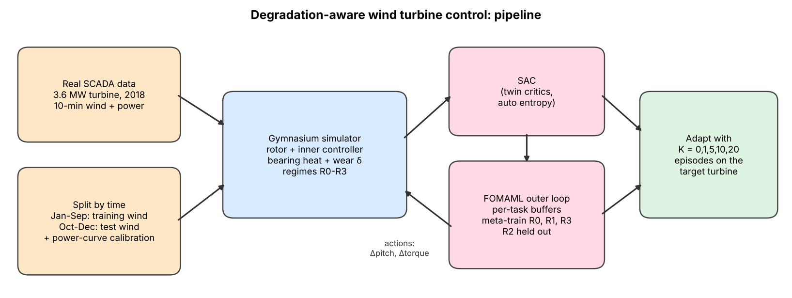
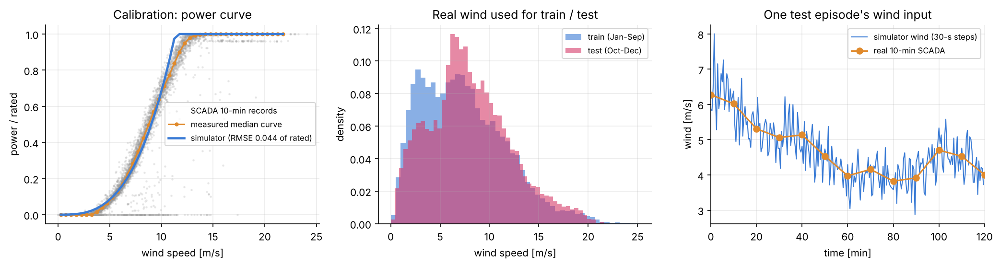
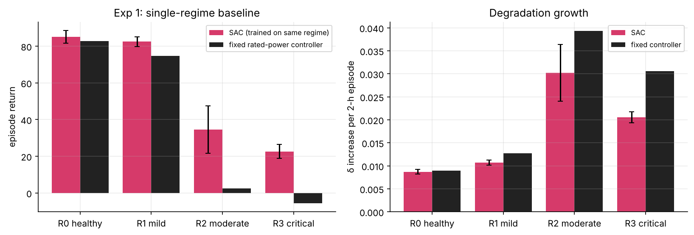
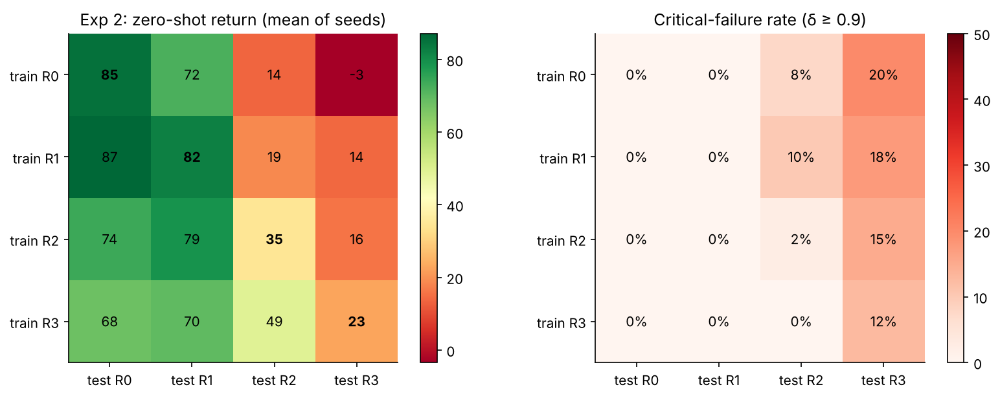
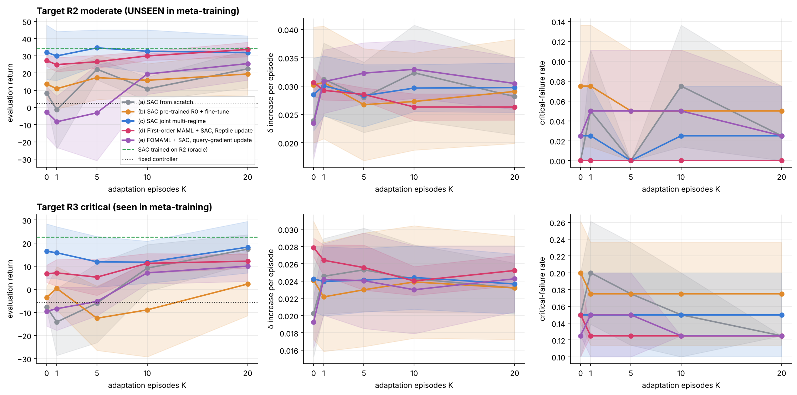
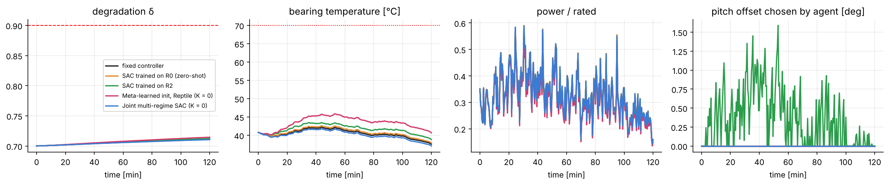
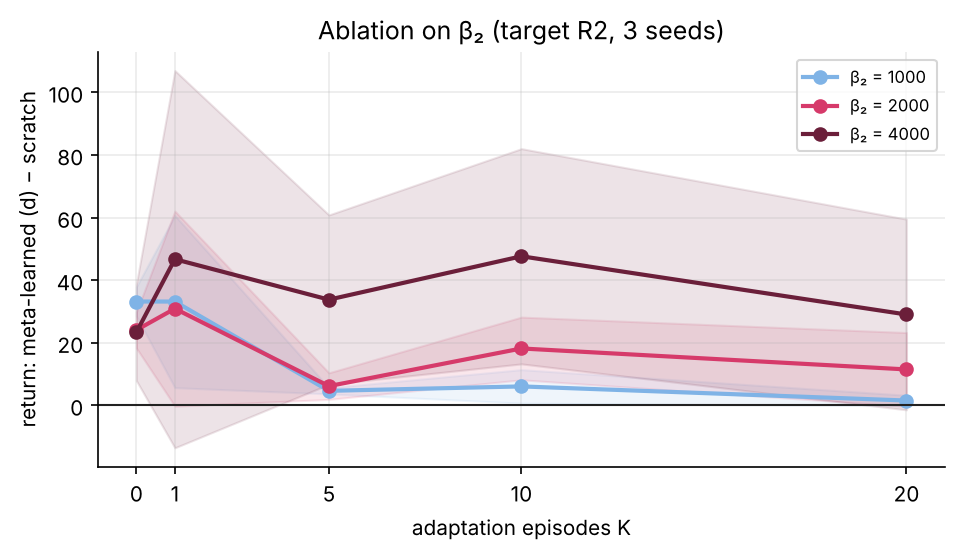
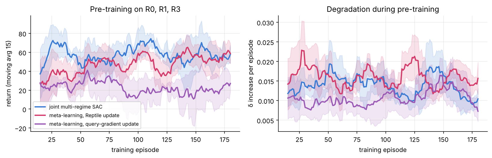

# Degradation-Aware Wind Turbine Control with SAC + FOMAML (real wind data)

**Course:** Applied Reinforcement Learning and Optimization (IM612031), IIT Kharagpur
**Team:** Rishabh Dehariya (23IM10028), Sourav Upadhyay(23IM10035)

It implements exactly the project proposal and nothing more: one simulator, one RL algorithm (SAC), first-order MAML for
meta-learning (in two variants), three baselines and the planned metrics. The simulator is driven by **real
measured wind** from a wind turbine's SCADA system.

> **Research question.** Does a MAML-initialised SAC controller reduce degradation growth and adapt
> faster after a regime change (including to a regime unseen during meta-training) than SAC trained
> from scratch or fine-tuned from another regime?



---

## 1. Repository layout

| Path | What it is |
|---|---|
| `data/T1.csv` | Real SCADA data: one 3.6 MW turbine, 10-minute records for all of 2018 (50,530 rows) |
| `windrl/data.py` | Loads and cleans the SCADA data, measured power curve, train/test split by date, wind segments |
| `windrl/env.py` | Gymnasium environment: rotor, inner controller, bearing heat, wear δ, regimes R0-R3, reward |
| `windrl/sac.py` | Soft Actor-Critic in plain PyTorch (tanh-Gaussian actor, twin critics, auto entropy) |
| `windrl/core.py` | Training, evaluation, few-shot adaptation, FOMAML meta-training, fixed controller |
| `experiments/run_all.py` | Runs Exp 1-4 + the β₂ ablation, writes `results/results.json` |
| `experiments/make_figures.py` | Builds every figure in `figures/` and the tables in `results/RESULTS.md` |
| `results/` | Raw results (`results.json`, per-job `jobs/*.json`), tables (`RESULTS.md`), trained models (`models/*.pt`), run log |

## 2. Quick start

```bash
pip install -r requirements.txt
python experiments/run_all.py --quick       # ~20 s smoke test of the whole pipeline
python experiments/run_all.py               # full run: 5 seeds (~63 min on 2 CPU cores)
python experiments/run_all.py --workers 8   # faster on a bigger machine / Colab
python experiments/make_figures.py          # figures + results/RESULTS.md
```

No GPU is needed. Everything is seeded, so a rerun reproduces the numbers.

## 3. Real data: what it is and how it is used

**Source.** *Wind Turbine SCADA Dataset* (B. Erisen, Kaggle), one turbine in Turkey, rated 3,600 kW,
2018, columns: timestamp, active power, hub-height wind speed, the manufacturer's theoretical power
curve, and wind direction. The copy in `data/` comes from the public GitHub mirror
[dominodatalab/reference-project-wind-turbine-scada](https://github.com/dominodatalab/reference-project-wind-turbine-scada).

The data does three jobs:

1. **Wind input.** Each episode replays a real 2-hour stretch of measured 10-minute wind speeds,
   linearly interpolated to the 1-second integration step, with small-scale turbulence added
   (Ornstein-Uhlenbeck, turbulence intensity 10 %, because 10-minute SCADA averages cannot contain
   second-scale gusts). Calm stretches (mean below 4 m/s, turbine idle) are skipped.
2. **Calibration.** The rotor size and power-coefficient scale are set so the simulator's steady-state
   power curve matches the turbine's *measured* power curve (after standard SCADA filtering of
   downtime and curtailment rows). See the left panel below.
3. **Honest train/test split by time.** Training (and adaptation) uses January-September 2018 wind;
   every evaluation uses October-December 2018 wind, which no policy ever trains on.



What the data does **not** contain: bearing temperatures, vibration or any degradation labels. Those
parts of the model are physics-style assumptions (Section 4), as in the proposal.

## 4. Simulator (`windrl/env.py`)

A simplified variable-speed turbine sized to the SCADA turbine (rotor radius 55 m, rated 3.6 MW).

**Rotor and wear (the proposal's equations):**

$$J\,\frac{d\omega}{dt} = T_{aero} - T_{gen} - B(1+\lambda\delta)\,\omega$$

$$\frac{d\delta}{dt} = k_1\,\omega_n^2 + k_2\,\max(T_{bearing}-T_{th},0)^2 + k_3\,|vibration|$$

- $T_{aero}$ comes from the Heier $C_p(\lambda,\beta)$ model, scaled by the calibrated factor η = 0.90.
- Bearing temperature relaxes (time constant 20 min) towards an operating-point value that rises with
  rotor speed, torque **and wear**: $T_{amb} + 25\,\omega_n^2(0.5+0.5\,\tau_n)(1+\delta)$ °C. A worn turbine
  runs hotter, so the same operation wears it faster. This coupling is what makes the best policy
  differ between regimes.
- Vibration grows with speed, wear and rotor acceleration (aggressive control is punished).
- Integration step 1 s; the agent acts every 30 s; one episode = 240 actions = 2 hours of operation.

**State (observation):** $[\omega, v, T_{gen}, T_{bearing}, P_{out}, \delta]$ as in the proposal,
plus the two current control offsets (the agent's actions are increments, so it needs to see where it
already is).

**Action (continuous, bounded):** the turbine keeps its standard inner controller (optimal-torque law
below rated wind, PI pitch control above). The agent is a **health-aware supervisor** that adjusts it:
- `a[0]`: blade-pitch offset change, ±2° per step, offset kept in [0°, 20°]
- `a[1]`: generator-torque gain change, ±0.05 per step, gain kept in [0.6, 1.3]

With both offsets neutral the turbine is exactly the **fixed rated-power controller** (the non-learning
reference in Exp 1).

**Reward (weights fixed for all methods):**

$$r_t = \beta_1\frac{P_{out}}{P_{rated}} - \beta_2(\delta_{t+1}-\delta_t) - \beta_3\max(T_{bearing}-T_{safe},0) - \beta_4\,\mathbb{1}_{unsafe}$$

with β = (1, 2000, 0.05, 2), $T_{safe}$ = 70 °C, unsafe = overspeed > 1.2× rated, bearing > 95 °C or
power > 1.15× rated. Crossing δ = 0.9 ends the episode as a **critical failure** (extra penalty 50).

**Health regimes = meta-learning tasks:** R0 healthy (δ 0-0.25), R1 mild (0.25-0.5), R2 moderate
(0.5-0.75), R3 critical (0.75-0.85 at the start, failure at 0.9). Each task also randomises the
friction growth λ ∈ [0.5, 1.5], the wear coefficients k₁-k₃ (±25 %) and the wind segment.
**R2 is held out entirely** from meta-training and joint training.

## 5. Methods (`windrl/sac.py`, `windrl/core.py`)

| | Method | Initialisation before adapting to the target turbine |
|---|---|---|
| (a) | SAC from scratch | random weights |
| (b) | SAC pre-trained on one regime + fine-tune | SAC trained on R0 (healthy) |
| (c) | SAC pre-trained on all regimes jointly | SAC trained on R0, R1, R3 mixed (the fairest control: same data, no meta-learning) |
| (d) | **First-order MAML + SAC, Reptile outer update** (main method) | meta-learned on R0, R1, R3 |
| (e) | FOMAML + SAC, query-gradient outer update | meta-learned on R0, R1, R3 |

**First-order MAML for off-policy SAC.** Every task (4 per training regime) keeps its own replay
buffer. Per meta-iteration, for one task from each training regime: clone θ → θ′, collect one episode
with θ′, then run SAC updates on θ′ (inner loop). No second derivatives are used in either variant.
The two variants differ only in the outer (meta) update:

- **(d) Reptile** (Nichol et al., 2018): θ ← θ + ε · mean(θ′ − θ), after 120 inner updates, with ε
  annealed from 1.0 to 0.1. This is the default.
- **(e) FOMAML query gradient** (Finn et al., 2017, first-order form): after 119 inner updates take the
  SAC-loss gradient at θ′ on a fresh batch, average over tasks and step θ with Adam.

Variant (e) is the textbook form named in the proposal. It is kept for transparency because, with only
60 outer steps, it barely moves θ (each meta step is one small Adam step on a noisy SAC loss), so its
initialisation stays close to random (Fig. 7). Reptile moves θ a large fraction of the way towards the
adapted weights at every step, which makes it usable at this budget. In both variants the meta
target-critic is the mean of the adapted learners' target critics.

**Equal budgets (so differences come from the method, not from compute):**
- pre-training: 60 iterations × 3 episodes = 180 episodes (43,200 steps) and 120 gradient computations
  per episode for (b), (c), (d), (e) and the single-regime SACs of Exp 1;
- adaptation: K episodes on the target turbine (training-period wind), 120 SAC updates after each.

**Metrics:** degradation increase per episode (δ_final − δ_initial), degradation slope (per hour),
average return, adaptation speed (episodes to recover 90 % of the oracle's improvement over the fixed
controller, where the oracle is SAC trained directly on that regime), critical-failure rate, and the
generalisation gap (same-regime minus cross-regime return). 5 seeds, mean ± std.

## 6. Results

All numbers below come from the full run (5 seeds, 62.6 min on 2 CPU cores). Every evaluation
uses October-December 2018 wind that no policy trained on. Full tables: `results/RESULTS.md`.

### 6.1 Main findings

1. **Learning helps most where the turbine is worn (Exp 1).** SAC trained on a regime beats the fixed
   rated-power controller in every regime, and the gap grows with degradation: on R2 the return is
   34.6 vs 2.4 and δ grows 24 % slower; on R3 δ grows 31 % slower and the critical-failure rate halves
   (12.5 % vs 25 %). On a healthy turbine (R0) the fixed controller is already near-optimal (82.7 vs 85.1).
2. **Policies do not transfer to more degraded regimes (Exp 2).** The healthy-turbine policy collapses
   on worn turbines (85 on R0 → 13.5 on R2 → −3.5 on R3, failure rate up to 20 %). Transfer the other
   way works much better: the R3 policy is conservative and does well on R0-R2. This asymmetry is the
   motivation for regime-aware adaptation.
3. **On the unseen regime R2, the meta-learned initialisation (d) adapts far better than training from
   scratch or fine-tuning a healthy-turbine policy.** With zero adaptation episodes it scores
   27.2 ± 3.3, about 3× scratch (8.3) and 2× the R0-pretrained policy (13.5), has **zero critical
   failures at every K**, and reaches 33.7 at K = 20 (oracle 34.6). Its spread across seeds is the
   smallest of all methods (± 3-4 vs ± 10-23).
4. **But joint multi-regime SAC (c), trained on exactly the same data without meta-learning, is as good
   or better on average** (32.0 at K = 0 on R2; 16.5 vs 6.7 on R3), with much larger seed-to-seed
   variance and a few failures. So in this testbed the benefit comes mainly from *training across
   regimes*; the meta-learning outer loop mostly buys consistency, not a higher mean. This matches
   reports that multi-task pre-training plus fine-tuning is a strong baseline for meta-RL
   (Mandi et al., 2022).
5. **The textbook query-gradient FOMAML (e) does not work at this budget**: it is worse than scratch
   for K ≤ 5 and its pre-training curve stalls (Fig. 7). Reptile's outer update is what makes
   first-order meta-learning usable here.
6. **Degradation per episode is hard to separate between methods.** After a few adaptation episodes all
   methods land at δ increases of 0.026-0.033 per 2-hour episode on R2, within one standard deviation
   of each other. The return differences come mostly from power capture, bearing temperature and
   failures, not from large differences in wear.
7. **β₂ ablation.** The advantage of (d) over scratch grows as wear is penalised more: at β₂ = 4000
   the return gap is +34 to +48 for K = 1-10 and (d) has lower δ growth at every K ≥ 1
   (up to −0.013 per episode). The meta-learned prior matters more when the reward cares about health.
8. **Research question, answered honestly:** a meta-initialised SAC *does* adapt faster and more
   safely than SAC from scratch or fine-tuned from the healthy regime, including on the held-out
   regime, but it does **not** beat a jointly trained multi-regime SAC on average return or wear.

### 6.2 Figures

**Exp 1 and Exp 2: single-regime baseline and the cross-regime gap**




**Exp 3-4: few-shot adaptation** (mean ± std over 5 seeds; dashed = SAC trained on the target regime,
dotted = fixed controller)



**One R2 test episode (δ₀ = 0.70, unseen wind)**. Differences within a single 2-hour episode are
small; the R2-specialist is the only policy that moves the pitch offset away from zero.



**β₂ ablation** (method (d) minus scratch, seeds 0-2) and **pre-training curves**




### 6.3 Tables

Seeds: 5 (mean ± std). Episode = 2 h of turbine operation (240 steps x 30 s). Evaluation: 8 fixed episodes with unseen Oct-Dec 2018 wind. Simulator power-curve RMSE vs measured SCADA curve: 0.044 of rated power.

### Exp 1: single-regime baseline

| Regime | SAC return | Fixed return | SAC δ increase | Fixed δ increase | SAC failure rate | Fixed failure rate |
|---|---|---|---|---|---|---|
| R0 healthy | 85.1 ± 3.4 | 82.7 | 0.009 ± 0.000 | 0.0090 | 0.000 ± 0.000 | 0.000 |
| R1 mild | 82.5 ± 2.6 | 74.6 | 0.011 ± 0.001 | 0.0127 | 0.000 ± 0.000 | 0.000 |
| R2 moderate | 34.6 ± 13.0 | 2.4 | 0.030 ± 0.006 | 0.0393 | 0.025 ± 0.050 | 0.125 |
| R3 critical | 22.6 ± 3.8 | -5.6 | 0.021 ± 0.001 | 0.0306 | 0.125 ± 0.000 | 0.250 |

### Exp 2: cross-regime return (rows = trained on, columns = tested on)

| | test R0 | test R1 | test R2 | test R3 |
|---|---|---|---|---|
| train R0 | 85.1 | 72.1 | 13.5 | -3.5 |
| train R1 | 87.2 | 82.5 | 18.8 | 14.2 |
| train R2 | 74.0 | 78.8 | 34.6 | 15.8 |
| train R3 | 67.9 | 69.8 | 49.2 | 22.6 |

Generalisation gap (same-regime minus cross-regime return):

| | test R0 | test R1 | test R2 | test R3 |
|---|---|---|---|---|
| train R0 | 0.0 | 10.4 | 21.0 | 26.1 |
| train R1 | -2.1 | 0.0 | 15.8 | 8.4 |
| train R2 | 11.1 | 3.7 | 0.0 | 6.8 |
| train R3 | 17.2 | 12.7 | -14.6 | 0.0 |

### Exp 3-4: adaptation to R2 moderate (unseen during meta-training)

| Method | return K=0 | return K=1 | return K=5 | return K=10 | return K=20 | δ increase K=5 | failure K=0 | failure K=5 | episodes to 90 % of oracle (per seed) |
|---|---|---|---|---|---|---|---|---|---|
| (a) SAC from scratch | 8.3 ± 5.3 | -1.3 ± 22.9 | 22.2 ± 6.2 | 10.8 ± 6.9 | 22.4 ± 11.1 | 0.028 ± 0.006 | 0.000 ± 0.000 | 0.000 ± 0.000 | never, 20, never, never, 5 |
| (b) SAC pre-trained R0 + fine-tune | 13.5 ± 8.5 | 10.9 ± 11.7 | 17.3 ± 12.8 | 15.8 ± 9.7 | 19.4 ± 12.2 | 0.027 ± 0.010 | 0.075 ± 0.061 | 0.050 ± 0.061 | never, never, never, 20, 1 |
| (c) SAC joint multi-regime | 32.0 ± 15.8 | 29.9 ± 14.2 | 34.6 ± 10.4 | 32.7 ± 12.4 | 31.9 ± 9.7 | 0.028 ± 0.005 | 0.025 ± 0.050 | 0.000 ± 0.000 | 0, 0, 0, 20, 5 |
| (d) First-order MAML + SAC, Reptile update | 27.2 ± 3.3 | 24.9 ± 4.1 | 26.6 ± 3.7 | 29.9 ± 2.6 | 33.7 ± 4.2 | 0.029 ± 0.001 | 0.000 ± 0.000 | 0.000 ± 0.000 | 10, 20, 0, 20, never |
| (e) FOMAML + SAC, query-gradient update | -2.6 ± 14.5 | -8.3 ± 14.9 | -3.1 ± 27.8 | 19.4 ± 11.8 | 25.5 ± 9.6 | 0.032 ± 0.005 | 0.025 ± 0.050 | 0.050 ± 0.061 | never, 20, 10, never, never |

Oracle (SAC trained on R2): 34.6; fixed controller: 2.4.

### Exp 3-4: adaptation to R3 critical (seen during meta-training)

| Method | return K=0 | return K=1 | return K=5 | return K=10 | return K=20 | δ increase K=5 | failure K=0 | failure K=5 | episodes to 90 % of oracle (per seed) |
|---|---|---|---|---|---|---|---|---|---|
| (a) SAC from scratch | -7.7 ± 1.2 | -14.2 ± 14.5 | -6.0 ± 17.1 | 9.2 ± 10.2 | 17.4 ± 6.3 | 0.025 ± 0.005 | 0.150 ± 0.050 | 0.175 ± 0.061 | 20, never, 10, never, never |
| (b) SAC pre-trained R0 + fine-tune | -3.5 ± 4.6 | 0.4 ± 9.4 | -12.5 ± 13.9 | -8.9 ± 20.3 | 2.3 ± 13.7 | 0.023 ± 0.007 | 0.200 ± 0.061 | 0.175 ± 0.061 | never, never, never, never, never |
| (c) SAC joint multi-regime | 16.5 ± 11.9 | 15.8 ± 11.3 | 11.9 ± 11.0 | 11.8 ± 9.1 | 18.3 ± 11.2 | 0.024 ± 0.004 | 0.150 ± 0.050 | 0.150 ± 0.050 | 0, 0, 20, never, 0 |
| (d) First-order MAML + SAC, Reptile update | 6.7 ± 3.7 | 7.1 ± 5.8 | 5.3 ± 7.9 | 11.3 ± 4.3 | 12.2 ± 3.0 | 0.026 ± 0.003 | 0.150 ± 0.050 | 0.125 ± 0.000 | never, never, never, never, never |
| (e) FOMAML + SAC, query-gradient update | -9.5 ± 6.4 | -8.4 ± 9.4 | -5.2 ± 6.2 | 7.1 ± 4.8 | 10.0 ± 6.6 | 0.024 ± 0.006 | 0.125 ± 0.000 | 0.150 ± 0.050 | never, never, never, never, never |

Oracle (SAC trained on R3): 22.6; fixed controller: -5.6.

### Ablation on β₂ (target R2, seeds 0-2): method (d) minus scratch

| β₂ | Δreturn K=0 | Δreturn K=1 | Δreturn K=5 | Δreturn K=10 | Δreturn K=20 | Δ(δ increase) K=0 | Δ(δ increase) K=1 | Δ(δ increase) K=5 | Δ(δ increase) K=10 | Δ(δ increase) K=20 |
|---|---|---|---|---|---|---|---|---|---|---|
| 1000 | 33.2 | 33.2 | 4.6 | 6.1 | 1.5 | +0.0079 | -0.0016 | -0.0040 | -0.0053 | -0.0019 |
| 2000 | 24.1 | 30.9 | 6.2 | 18.2 | 11.5 | +0.0077 | -0.0003 | -0.0035 | -0.0096 | -0.0041 |
| 4000 | 23.4 | 46.7 | 33.8 | 47.6 | 29.0 | +0.0034 | -0.0052 | -0.0094 | -0.0132 | -0.0075 |


## 7. What was removed from HMARL-DRT, and why

| Removed | Reason |
|---|---|
| GP / iPAE agent, PINN agent, foundation-model agent, LAYA agent | Not in the proposal; one learner (SAC) is enough to answer the research question |
| Shared embedding space, MoE arbiter, transfer-learning hub | Only needed to combine several agents |
| Dynamic (phase-adaptive) reward shaper | The proposal fixes the reward weights for all methods on purpose |
| CEMRL / EWC continual learning, PEARL code | PEARL was an optional stretch baseline; EWC is not part of the plan |
| FastAPI backend, Streamlit dashboard, vendored `fastapi`/`plotly`/`pydantic` stubs | Not needed for an RL course project |
| ~20 validation / deep-dive scripts and ~25 YAML configs | Replaced by one runner and one figure script |
| 8-D state with grid demand and weather forecast, maintenance action | Back to the proposal's state and the two control actions |
| Synthetic sine-wave wind | Replaced by real 2018 SCADA wind with a time-based train/test split |

The old environment also had a few modelling problems that the new one avoids (normalised and SI
units mixed in the rotor equation, a hard-coded 15° base pitch, wind not tied to any data).

## 8. Limitations

- The simulator is deliberately simple and is not full turbine physics (no tower/blade loads,
  no yaw, a lumped bearing temperature model). It is a proof-of-concept testbed.
- Bearing temperature, vibration and wear coefficients are assumptions, not fitted to data,
  because the public SCADA file has no such channels.
- Wear is accelerated so that regime effects show up within 2-hour episodes.
- Budgets are small (180 pre-training episodes, 5 seeds) so the whole study runs on a laptop CPU in
  about an hour; with this many seeds several differences in Section 6 are within one standard deviation.
- The β₂ ablation uses 3 seeds and re-trains only method (d) and scratch.

## References

1. T. Haarnoja et al., Soft Actor-Critic, ICML 2018.
2. C. Finn, P. Abbeel, S. Levine, Model-Agnostic Meta-Learning, ICML 2017.
3. A. Nichol, J. Achiam, J. Schulman, On First-Order Meta-Learning Algorithms, arXiv:1803.02999, 2018.
4. K. Rakelly et al., PEARL, ICML 2019.
5. M. Towers et al., Gymnasium, arXiv:2407.17032, 2024.
6. J. Jonkman et al., NREL 5-MW Reference Wind Turbine, NREL/TP-500-38060, 2009.
7. B. Erisen, Wind Turbine SCADA Dataset, Kaggle, 2018.
8. Z. Mandi, P. Abbeel, S. James, On the Effectiveness of Fine-tuning Versus Meta-reinforcement Learning, NeurIPS 2022 (arXiv:2206.03271).
