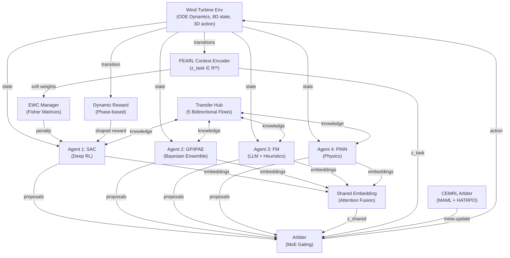

# HMARL-DRT — Complete Technical Reference & Mathematical Deep-Dive

**Framework:** Heterogeneous Multi-Agent Reinforcement Learning with Dynamic Reward Shaping & Transfer Learning (HMARL-DRT) + Continual Environment Meta-Reinforcement Learning (CEMRL)

**Domain:** Predictive maintenance and adaptive control of wind turbines under degradation

**Author:** Bhanu Venkata Sai Phani Chatti
**Date:** 2026-09-09

---

## Table of Contents

1. [System Overview](#1-system-overview)
2. [The Wind Turbine Simulation Environment](#2-the-wind-turbine-simulation-environment)
   - 2.1 The 8D Sensor Space
   - 2.2 The 3D Action Space
   - 2.3 Physical Constants
   - 2.4 The Full ODE Model
   - 2.5 Step-by-Step Simulation Walkthrough
   - 2.6 Degradation Dynamics & the 4 Regimes
   - 2.7 Termination, Safety & Reward
3. [The Four Heterogeneous Agents](#3-the-four-heterogeneous-agents)
   - 3.1 SAC Agent (Deep RL)
   - 3.2 GP Agent (Bayesian Ensemble)
   - 3.3 FM Agent (Foundation Model / LLM)
   - 3.4 PINN Agent (Physics-Informed)
   - 3.5 Why SAC for This Use Case
4. [Action Gating & the Arbiter](#4-action-gating--the-arbiter)
   - 4.1 Standard Arbiter
   - 4.2 Degradation-Aware Routing
   - 4.3 CEMRL Arbiter (Meta-Learning Gating)
5. [The CEMRL Stack](#5-the-cemrl-stack)
   - 5.1 PEARL Context Encoder
   - 5.2 EWC (Elastic Weight Consolidation)
   - 5.3 MAML (Model-Agnostic Meta-Learning)
   - 5.4 HATRPO (Heterogeneous-Agent Trust Region Policy Optimization)
   - 5.5 MAML Warm-Start Manager
   - 5.6 TSFM Regime Detector
6. [Dynamic Reward Shaping](#6-dynamic-reward-shaping)
7. [Transfer Learning Hub](#7-transfer-learning-hub)
8. [The iPAE Module](#8-the-ipae-module)
9. [The Training Loop](#9-the-training-loop)
10. [Results & RUL Calculation](#10-results--rul-calculation)
11. [Honest Assessment of Claims](#11-honest-assessment-of-claims)

---

# 1. System Overview

**HMARL-DRT** is a research framework for **predictive maintenance and adaptive control of wind turbines**. The central idea is that no single AI paradigm excels at all aspects of industrial control, so the system combines **four fundamentally different agents**:

| Agent | Paradigm | Role |
|-------|----------|------|
| **SAC** | Deep Reinforcement Learning | Primary policy optimizer (dominant mid/late training) |
| **GP/iPAE** | Bayesian / Uncertainty Quantification | Safe exploration, RUL estimation, uncertainty |
| **FM** | Foundation Model / LLM + Heuristics | High-level reasoning, reward weight suggestion, anomaly detection |
| **PINN** | Physics-Informed Neural Network | Safety-critical control (dominant early training & emergencies) |

These agents collaborate through:
1. **Shared Embedding Space** — attention-weighted fusion of agent encodings into `z_shared`
2. **Arbiter (MoE Gating)** — learns how much to trust each agent per state
3. **Dynamic Reward Shaper** — 5-component phase-adaptive reward
4. **Transfer Learning Hub** — 5 bidirectional knowledge flows
5. **CEMRL Stack** — PEARL (regime ID) + EWC (anti-forgetting) + MAML (fast adaptation) + HATRPO (safe updates)

The system operates on a **degradation index δ ∈ [0,1]** that defines 4 operational regimes. The agents must control the turbine safely as degradation progresses, and the CEMRL stack prevents them from "forgetting" how to control previously-seen regimes.

---

# 2. The Wind Turbine Simulation Environment

**File:** `hmarl_drt/envs/wind_turbine_env.py`

This is a custom **Gymnasium** environment simulating a single 5 MW wind turbine via coupled ODE dynamics.

## 2.1 The 8D Sensor Space

The observation vector is 8-dimensional. These are the "sensors" the agents read every timestep:

| Index | Signal | Symbol | Range | Physical Meaning |
|-------|--------|--------|-------|------------------|
| 0 | `omega` | ω | [0, 2] rad/s | Rotor angular speed |
| 1 | `v_wind` | v | [0, 30] m/s | Wind speed |
| 2 | `T_gen` | T_g | [0, 1] pu | Generator torque setpoint (normalized) |
| 3 | `T_bearing` | T_b | [0, 150] °C | Bearing temperature |
| 4 | `P_out` | P | [0, 1.5] pu | Power output (normalized to 5 MW rated) |
| 5 | `delta` | δ | [0, 1] | **Degradation index** (the health metric) |
| 6 | `grid_demand` | D | [0, 1] | Normalized grid load demand |
| 7 | `weather` | W | [0, 1] | Weather forecast proxy |

The observation space is defined as a `gymnasium.spaces.Box`:

```python
state_low  = np.array([0.0, 0.0, 0.0, 0.0, 0.0, 0.0, 0.0, 0.0], dtype=np.float32)
state_high = np.array([2.0, 30.0, 1.0, 150.0, 1.5, 1.0, 1.0, 1.0], dtype=np.float32)
```

## 2.2 The 3D Action Space

The action vector is 3-dimensional, continuous, all in `[-1, 1]`:

| Index | Signal | Symbol | Physical Range | Effect |
|-------|--------|--------|----------------|--------|
| 0 | `delta_pitch` | Δβ | ±15° around 15° base | Blade pitch adjustment (feathering) |
| 1 | `delta_torque` | ΔT_g | ±0.1 pu | Generator torque setpoint adjustment |
| 2 | `maintenance_signal` | m | [0, 1] (mapped from [-1,1]) | Continuous maintenance flag |

```python
self.action_space = spaces.Box(
    low=np.array([-1.0, -1.0, -1.0], dtype=np.float32),
    high=np.array([1.0, 1.0, 1.0], dtype=np.float32),
)
```

## 2.3 Physical Constants

| Symbol | Value | Meaning |
|--------|-------|---------|
| J | 1e6 kg·m² | Rotor moment of inertia |
| B | 100 N·m·s/rad | Damping/friction coefficient |
| R | 40 m | Rotor radius |
| ρ | 1.225 kg/m³ | Air density |
| C_th | 5000 J/K | Thermal capacitance |
| h_conv | 10 W/K | Convective heat transfer coefficient |
| dt | 0.1 s | Simulation timestep |
| P_rated | 5e6 W | Rated power (5 MW) |
| ω_min | 0.5 rad/s | Min rotor speed (safety bound) |
| ω_max | 1.5 rad/s | Max rotor speed (safety bound) |
| T_max | 100 °C | Max bearing temperature (safety bound) |
| δ_crit | 0.9 (or 0.98) | Critical degradation threshold (failure) |

## 2.4 The Full ODE Model

The environment integrates **three coupled ODEs** each timestep:

### Rotor dynamics
$$\frac{d\omega}{dt} = \frac{1}{J}\left(T_{aero}(\lambda, \beta) - T_{gen} - B\omega\right)$$

### Thermal dynamics
$$\frac{dT_b}{dt} = \frac{1}{C_{th}}\left(P_{loss} - h_{conv}(T_b - T_{amb})\right)$$

### Degradation dynamics
$$\frac{d\delta}{dt} = f_{deg}(\omega, T_b, F_{vib})$$

where the aerodynamic torque uses a simplified power-coefficient model (based on the classic NREL Cp curve shape).

## 2.5 Step-by-Step Simulation Walkthrough

### Step 0 — Reset (episode start)

Each state variable is initialized from a uniform random distribution:

```
omega       ~ U(0.8, 1.2)      rad/s
v_wind      ~ U(5.0, 15.0)     m/s
T_gen       ~ U(0.3, 0.7)      pu
T_bearing   ~ U(30.0, 50.0)    °C
P_out       ~ U(0.2, 0.6)      pu
delta       ~ U(0.0, 0.2)      (or from a forced delta_range for regime sampling)
grid_demand ~ U(0.3, 0.9)
weather     ~ U(0.3, 0.8)
```

The base wind speed `v_base` is stored so wind can oscillate around it during the episode.

### Step 1 — Action decoding

The raw action `a ∈ [-1,1]³` is mapped to physical quantities:

```
delta_pitch  = a[0] * 15.0        → ±15° pitch change
delta_torque = a[1] * 0.1         → ±0.1 pu torque change
maintenance  = (a[2] + 1) / 2     → maps [-1,1] to [0,1]
beta         = clamp(15 + delta_pitch, 0, 30)   → absolute pitch angle in degrees
T_gen_new    = clamp(T_gen + delta_torque, 0, 1)
```

### Step 2 — Aerodynamic torque (the core physics)

The **tip-speed ratio** is:

$$\lambda = \frac{\omega \cdot R}{v_{wind}}$$

A simplified power-coefficient approximation is used:

$$\text{denom} = \lambda + 0.08\beta + 10^{-6}$$

$$C_Q = \text{clamp}\left(0.5 \cdot \left(0.22 \cdot \left(\frac{116}{\text{denom}} - 0.4\beta - 5\right) \cdot e^{-12.5/\text{denom}}\right),\; -0.1,\; 0.5\right)$$

Then the **aerodynamic torque**:

$$T_{aero} = \frac{1}{2}\rho \pi R^3 v_{wind}^2 C_Q$$

### Step 3 — Rotor speed ODE integration

$$\frac{d\omega}{dt} = \frac{T_{aero} - T_{gen,new} \cdot 10^6 - B\omega}{J}$$

$$\omega_{new} = \text{clamp}\left(\omega + \frac{d\omega}{dt} \cdot dt,\; 0,\; 2\right)$$

### Step 4 — Power output

$$P_{out,new} = \text{clamp}\left(\frac{T_{gen,new} \cdot \omega_{new}}{P_{rated}},\; 0,\; 1.5\right)$$

### Step 5 — Thermal dynamics ODE integration

Heat generation from losses:

$$P_{loss} = 0.02 \cdot (\omega_{new}^2 + T_{gen,new}^2) \cdot 10^6$$

$$\frac{dT_b}{dt} = \frac{P_{loss} - h_{conv}(T_b - 25)}{C_{th}}$$

$$T_{b,new} = \text{clamp}\left(T_b + \frac{dT_b}{dt} \cdot dt,\; 0,\; 150\right)$$

### Step 6 — Degradation dynamics ODE integration (the key health signal)

Vibration is modeled as:

$$\text{vibration} = 0.5\omega_{new}^2 + 0.1 \cdot \mathcal{N}(0,1)$$

The degradation rate depends on speed, temperature stress, and vibration:

$$\text{deg\_rate} = 10^{-5} \cdot \left(\omega_{new}^2 + 0.01 \cdot \max(T_{b,new} - 60,\; 0)^2 + 0.1 \cdot |\text{vibration}|\right)$$

**Maintenance effect**: if the maintenance signal `> 0.7`, the degradation rate is multiplied by 0.1 (10× slower):

$$\delta_{new} = \text{clamp}\left(\delta + \text{deg\_rate} \cdot dt,\; 0,\; 1\right)$$

### Step 7 — Environmental variation

Wind oscillates around the base wind with a sinusoid + noise:

$$v_{wind,new} = \text{clamp}\left(v_{base} + 3\sin(0.01 \cdot t) + 0.5\mathcal{N}(0,1),\; 0,\; 30\right)$$

Grid demand and weather drift with small random noise:

$$D_{new} = \text{clamp}(D + 0.01\mathcal{N}(0,1),\; 0,\; 1)$$
$$W_{new} = \text{clamp}(W + 0.005\mathcal{N}(0,1),\; 0,\; 1)$$

### Step 8 — Termination & safety

```
terminated = (delta_new >= delta_crit)
truncated  = (step_count >= max_steps)
physics_violated = (omega > 1.5) OR (omega < 0.5) OR (T_bearing > 100)
```

### Step 9 — Reward

The env returns a **placeholder reward** (the real reward comes from the Dynamic Reward Shaper):

$$r = P_{out,new} - 0.5 \cdot \max(\delta_{new} - 0.5,\; 0)$$

## 2.6 Degradation Dynamics & the 4 Regimes

The degradation index δ defines **4 operational regimes**:

| Regime | δ Range | Status | Control Priority |
|--------|---------|--------|------------------|
| **0** | [0.0, 0.25] | Healthy | Maximize energy; minimize wear |
| **1** | [0.25, 0.50] | Degrading | Balance energy + early damage detection |
| **2** | [0.50, 0.75] | Critical | Prioritize safety + RUL prediction |
| **3** | [0.75, 0.95] | Emergency | Emergency override; prepare maintenance |

These ranges are configurable in `configs/wind_supervised.yaml`:

```yaml
regime_delta_ranges:
  "0": [0.0, 0.25]
  "1": [0.25, 0.50]
  "2": [0.50, 0.75]
  "3": [0.75, 0.95]
regime_probs: [0.25, 0.25, 0.25, 0.25]
```

**Key design point — delta masking:** In CEMRL latent mode (`mask_true_delta: true`), `state[5]` is zeroed before agents see it. This forces the PEARL encoder to **infer degradation** from the other 7 signals rather than reading it directly — which is the regime detection challenge.

---

# 3. The Four Heterogeneous Agents

**Directory:** `hmarl_drt/agents/`

## 3.1 SAC Agent (Deep RL) — `sac_agent.py`

### 3.1.1 What it is

**Soft Actor-Critic (SAC)** is a state-of-the-art **off-policy maximum-entropy deep RL** algorithm. It is the "primary" agent — the main policy optimizer that dominates in mid/late training.

### 3.1.2 Architecture

```
Actor:
  encoder: Linear(8, 128) → ReLU
  net:     Linear(128 + 64, 256) → ReLU → Linear(256, 256) → ReLU
  mean_head:     Linear(256, 3)
  log_std_head:  Linear(256, 3)  (clamped to [-20, 2])
  → tanh squashing → action ∈ [-1,1]³

Critic (twin):
  input: [state(8) + z_shared(64) + action(3)] = 75
  q1: Linear(75, 256) → ReLU → Linear(256, 256) → ReLU → Linear(256, 1)
  q2: (same structure, independent weights)
```

### 3.1.3 The Math

**Policy (Gaussian with tanh squashing):**

The actor outputs a Gaussian distribution over actions:

$$\pi(a|s) = \mathcal{N}(\mu_\theta(s), \sigma_\theta(s))$$

The reparameterization trick samples:

$$x \sim \mathcal{N}(\mu, \sigma), \quad a = \tanh(x)$$

The log-probability with tanh squashing correction:

$$\log\pi(a|s) = \log\mathcal{N}(x;\mu,\sigma) - \log(1 - \tanh^2(x) + \epsilon)$$

**Objective (maximum entropy):**

$$\pi^* = \arg\max_\pi \mathbb{E}\left[\sum_t \gamma^t \left(r_t + \alpha \mathcal{H}(\pi(\cdot|s_t))\right)\right]$$

**Critic loss (Clipped Double-Q):**

The target uses the minimum of two target critics to reduce overestimation bias:

$$y = r + \gamma(1-d)\left(\min(Q_1', Q_2') - \alpha \log\pi(a'|s')\right)$$

$$L_{critic} = \text{MSE}(Q_1(s,a), y) + \text{MSE}(Q_2(s,a), y) + 0.1 \cdot \text{physics\_reg}$$

where `physics_reg` is the physics regularization from the PINN agent (transfer path T1).

**Actor loss (maximum entropy):**

$$L_{actor} = \mathbb{E}\left[\alpha \log\pi(a|s) - \min(Q_1, Q_2)\right] - 0.05 \cdot \text{uncertainty\_bonus}$$

where `uncertainty_bonus` comes from the GP agent (transfer path T3).

**Auto entropy tuning:**

The temperature α is learned to match a target entropy:

$$\alpha^* = \arg\min_\alpha \mathbb{E}\left[-\alpha \log\pi(a|s) - \alpha \cdot H_{target}\right]$$

with target entropy:

$$H_{target} = -\text{action\_dim} = -3$$

**Soft target update:**

$$\theta'_{target} \leftarrow \tau\theta + (1-\tau)\theta'_{target}, \quad \tau = 0.005$$

**EWC penalty** (when CEMRL enabled):

$$L_{actor} += \frac{\lambda_{EWC}}{2}\sum_j w_j(z_{task}) \sum_i F_{ji}(\theta_i - \theta^*_{ji})^2$$

### 3.1.4 Inputs & Processing

- **Inputs**: raw state `s` (8D), shared embedding `z_shared` (64D), optional `z_task` (32D) for EWC
- **Processing**: actor encodes state → concatenates with z_shared → MLP → mean/log_std → reparameterization → tanh action
- **Output**: 3D continuous action proposal

### 3.1.5 Fisher Computation for EWC

When a regime transition is detected, `trigger_regime_fisher_computation` computes the Fisher Information Matrix for the actor:

1. Convert the regime buffer to a batch of states
2. Compute shared embeddings for each state
3. Define the actor loss function (maximize Q - entropy)
4. Call `ewc_manager.compute_fisher("sac_actor", actor, ...)`

## 3.2 GP Agent (Bayesian Ensemble) — `gp_agent.py`

### 3.2.1 What it actually is

Despite the name, this is **not a true Gaussian Process** — it is a **deep ensemble of 5 MLPs** (a scalable GP approximation that avoids the O(n³) cost of exact GPs). This is a deliberate scalability choice documented in the code:

> "Uses a simple parametric approximation for scalability (avoids full GP cubic cost)."

### 3.2.2 Architecture

```
UncertaintyNetwork: 5 × [Linear(8,128) → ReLU → Linear(128,128) → ReLU → Linear(128,3)]
Encoder: Linear(8,64) → ReLU → Linear(64,32)   (for shared embedding)
```

### 3.2.3 The Math

**Ensemble prediction:**

$$\mu_a = \frac{1}{N}\sum_{k=1}^{N} f_k(s), \quad \sigma^2 = \frac{1}{N}\sum_{k=1}^{N}\left(f_k(s) - \mu_a\right)^2$$

where N = 5. The variance is the **epistemic uncertainty** — high disagreement between ensemble members = the model is uncertain about that state.

**Action:** `a = tanh(μ_a)` (ensemble mean, squashed to [-1,1])

**Uncertainty:** `σ² = var.mean(dim=-1)` — used as:
- Exploration bonus for SAC (transfer T3)
- Safety signal for the arbiter (high uncertainty → boost physics)

**RUL estimation** (linear extrapolation of degradation):

```
delta = state[5] (or delta_override)
append delta to degradation_history (maxlen=500)

if len(history) < 10:  return 1000.0   # default high RUL
rate = mean(diff(deltas[-20:]))          # average degradation rate
if rate <= 0:  return 1000.0             # no degradation → high RUL
RUL = max(0, (0.9 - delta) / rate)       # steps until critical (δ=0.9)
```

**Update loss** (imitation of actions):

$$L = \sum_{k=1}^{N} \text{MSE}(\tanh(f_k(s)), a)$$

### 3.2.4 Inputs & Processing

- **Inputs**: raw state (8D)
- **Processing**: ensemble forward → mean + variance
- **Outputs**: action proposal (3D), uncertainty scalar, RUL estimate, 32D embedding

## 3.3 FM Agent (Foundation Model / LLM) — `fm_agent.py`

### 3.3.1 What it is

A **hybrid LLM + heuristic agent**. It can query an external LLM API (Siemens LLM gateway, `gpt-oss-120b` or `gpt-4o-mini`) to suggest reward weights, but **falls back to rule-based heuristics** when no API is available (which is the default in most configs).

### 3.3.2 The Math / Logic

**LLM path** (`_query_api_reward_weights`):

1. Serializes the 8D state to JSON
2. Prompts the LLM: *"Given turbine state JSON, return ONLY JSON with keys: energy, rul, safety, physics, curiosity, confidence. All weights in [0,1], confidence in [0,1], weights sum to 1."*
3. Parses the response, clips weights to [0,1], normalizes to sum to 1
4. Uses async polling (ThreadPoolExecutor) so it doesn't block the RL loop

**Heuristic path** (`get_reward_weights`):

```
if delta > 0.7:       weights = {energy:0.10, rul:0.60, safety:0.20, physics:0.05, curiosity:0.05}, conf=0.9
elif T_bearing > 85:  weights = {energy:0.10, rul:0.20, safety:0.50, physics:0.15, curiosity:0.05}, conf=0.85
elif grid_demand>0.8: weights = {energy:0.50, rul:0.20, safety:0.15, physics:0.10, curiosity:0.05}, conf=0.75
else:                 weights = {energy:0.30, rul:0.25, safety:0.20, physics:0.15, curiosity:0.10}, conf=0.6
```

**Action** (rule-based):

```
if delta > 0.7:       pitch=0.5, torque=-0.3, maint=1.0   (critical: reduce load, flag maintenance)
elif T_bearing > 80:  pitch=0.3, torque=-0.5              (high temp: reduce torque)
elif v_wind > 20:     pitch=0.7                            (high wind: feather blades)
```

**Anomaly detection:**

```
if delta > 0.8:       CRITICAL — immediate maintenance
if T_bearing > 95:    CRITICAL — bearing temp unsafe
if omega > 1.4 or < 0.55: WARNING — rotor speed out of range
```

**Regime-based weight adjustment** (`get_weight_adjustment`):

Each regime has a fixed adjustment vector, scaled by confidence:

```
Regime 0: {energy:-0.03, rul:0.02, safety:0.05, physics:0.03, curiosity:-0.02, degradation:-0.05}
Regime 1: {energy:-0.05, rul:0.05, safety:0.08, physics:0.04, curiosity:-0.02, degradation:-0.10}
Regime 2: {energy:-0.08, rul:0.08, safety:0.12, physics:0.05, curiosity:-0.03, degradation:-0.14}
Regime 3: {energy:-0.10, rul:0.12, safety:0.18, physics:0.05, curiosity:-0.05, degradation:-0.20}
```

### 3.3.3 Inputs & Processing

- **Inputs**: raw state (8D)
- **Processing**: LLM query OR heuristic rules
- **Outputs**: reward weight suggestion (5D), action proposal (3D), anomaly flag, semantic embedding (128D)

## 3.4 PINN Agent (Physics-Informed Neural Network) — `pinn_agent.py`

### 3.4.1 What it is

The **safety-critical physics agent**. It learns the turbine dynamics `f(s,a) → ds/dt` and acts as a conservative proportional controller. It is dominant in early training (when data is sparse) and in emergencies.

### 3.4.2 Architecture

```
PINNNetwork: [state(8) + action(3)] → Linear(11,128) → Tanh → Linear(128,128) → Tanh → Linear(128,8)
ResidualNet: [state(8) + action(3)] → Linear(11,64) → ReLU → Linear(64,8)   (for T4 transfer)
```

### 3.4.3 The Math

**ODE residual loss** (physics constraint):

$$\lambda = \frac{\omega R}{v_{wind}}, \quad \text{denom} = \lambda + 0.08\beta + 10^{-6}$$

$$C_Q = 0.5\left(0.22\left(\frac{116}{\text{denom}} - 0.4\beta - 5\right)e^{-12.5/\text{denom}}\right)$$

$$T_{aero} = \frac{1}{2}\rho\pi R^3 v^2 C_Q$$

$$\frac{d\omega}{dt}_{physics} = \frac{T_{aero} - T_{gen}\cdot10^6 - B\omega}{J}$$

$$L_{ODE} = \text{MSE}\left(\frac{d\omega}{dt}_{pred},\; \frac{d\omega}{dt}_{physics}\right)$$

**Total update loss:**

$$L = L_{data} + L_{ODE} = \text{MSE}(\hat{ds/dt}, \Delta s) + \text{MSE}(\hat{d\omega/dt}, d\omega/dt_{physics})$$

**Action** (proportional controller):

```
if omega > 0.8*omega_max:   pitch = min(1, (omega - 0.8*omega_max)/(0.2*omega_max))   # feather to slow down
elif omega < 1.2*omega_min: pitch = max(-1, -(1.2*omega_min - omega)/(0.2*omega_min)) # speed up
if T > 0.8*T_max:           torque_adj = -min(1, (T - 0.8*T_max)/(0.2*T_max))          # reduce load
maint = -1.0  (no maintenance by default)
```

**Safe bounds** (tightened near constraints):

```
if omega > 0.9*omega_max: beta_min_norm = 0.0   (force pitch increase)
if T > 0.9*T_max:         beta_min_norm = max(beta_min_norm, 0.3)
```

### 3.4.4 Inputs & Processing

- **Inputs**: raw state (8D)
- **Processing**: physics ODE + learned dynamics
- **Outputs**: conservative action (3D), safe bounds, ODE residual

## 3.5 Why SAC for This Use Case

SAC is chosen as the primary deep RL agent because it is the **state-of-the-art off-policy maximum-entropy RL algorithm**, ideal for this problem:

1. **Continuous action space**: The turbine needs continuous pitch/torque/maintenance commands — SAC natively handles continuous actions via a Gaussian policy with tanh squashing.

2. **Sample efficiency**: Off-policy with a replay buffer → far fewer environment interactions than on-policy methods (PPO/TRPO). Each env step is expensive (ODE integration), so sample efficiency matters.

3. **Exploration vs exploitation balance**: The entropy term `α·H(π)` encourages systematic exploration — critical in a safety-critical domain where you must discover safe operating regions.

4. **Stability**: Twin Q-networks (Clipped Double-Q) reduce overestimation bias, and the soft target update (τ) stabilizes training.

5. **Integration-friendly**: The actor naturally accepts the shared embedding `z_shared` as extra input, making it the natural "primary" agent in the heterogeneous ensemble.

6. **Comparison with alternatives**:
   - **PPO/TRPO**: on-policy → sample-inefficient for expensive simulators
   - **DDPG/TD3**: deterministic policies → less exploration, more prone to local optima
   - **DQN**: discrete actions only → unsuitable for continuous control
   - **SAC**: maximum entropy → best exploration/stability tradeoff for continuous control

---

# 4. Action Gating & the Arbiter

**Files:** `hmarl_drt/core/arbiter.py`, `hmarl_drt/core/cemrl_arbiter.py`

## 4.1 Standard Arbiter

The **Arbiter** is the meta-controller that fuses the 4 action proposals into a single safe action.

### Gating network

```
GatingNetwork: [state(8) + z_task(32) + delta(1)] → Linear(41,128) → ReLU → Linear(128,128) → ReLU → Linear(128,4)
g_k = softmax(logits / temperature)
```

### The combination math

$$a_{combined} = \sum_{k=1}^{4} g_k \cdot a_k$$

$$a_{safe} = \text{clip}(a_{combined}, \text{safe\_bounds})$$

### Training the gating network

The arbiter is trained via **policy gradient (REINFORCE with baseline)**:

$$L = -\mathbb{E}\left[\sum_k \nabla\log g_k \cdot (r - b)\right]$$

where `b = mean(rewards)` is the baseline.

## 4.2 Degradation-Aware Routing

The learned weights are blended with a **hand-crafted bias** (70% learned / 30% bias):

$$g_{final} = \frac{0.7 \cdot g_{learned} + 0.3 \cdot g_{bias}}{\sum(\cdot)}$$

| Regime | δ range | Bias vector [SAC, GP, FM, PINN] | Rationale |
|--------|---------|----------------------------------|-----------|
| Healthy | δ < 0.3 | [0.30, 0.15, 0.05, 0.50] | Physics-dominant, conservative |
| Degrading | 0.3–0.7 | [0.40, 0.30, 0.10, 0.20] | SAC-dominant, adaptive |
| Critical | > 0.7 | [0.05, 0.50, 0.25, 0.20] | GP/iPAE-dominant, uncertainty-aware |
| Emergency | anomaly | [0, 0, 0, 1.0] | **Full physics override** |

If uncertainty > 0.5, physics weight is boosted to ≥ 0.4 for safety.

## 4.3 CEMRL Arbiter (Meta-Learning Gating)

`core/cemrl_arbiter.py` adds meta-learning to the gating:

### Architecture

```
MetaGatingNetwork: [state(8) + z_task(32) + delta(1) + uncertainty(1)] → Linear(42,128) → ReLU → Linear(128,128) → ReLU → Linear(128,4)
```

### Workflow

1. **PEARL** identifies current regime via `z_task` (no gradients)
2. **MAML** adapts gating network in 1-5 inner loop steps
3. **HATRPO** ensures safe routing updates (KL constraint)
4. **EWC** protects gating parameters for all past regimes

### Emergency override

```python
if emergency:
    weights_np = np.array([0.0, 0.0, 0.0, 1.0])  # Full physics control
    safe_action = np.clip(actions[3], safe_bounds["low"], safe_bounds["high"])
```

---

# 5. The CEMRL Stack

## 5.1 PEARL Context Encoder — `context_encoder.py`

### What it does

**PEARL** (Probabilistic Embeddings for Actor-critic RL, Rakelly et al. 2019) identifies the **current degradation regime** from recent experience, without needing gradient steps. It maps a rolling context buffer of transitions to a latent task embedding `z_task ∈ R³²`.

### The Math

**Input encoding**: each transition is concatenated:

$$x_h = [s_h,\; a_h,\; r_h,\; s'_h] \in \mathbb{R}^{8+3+1+8} = \mathbb{R}^{20}$$

**Encoder**: `Linear(20,128) → ReLU → Linear(128,128) → ReLU → Linear(128,32)`

**Task embedding** (mean pooling over the context window):

$$z_{task} = \frac{1}{H}\sum_{h=1}^{H} f_\phi(x_h)$$

**Progressive context window**: H grows from 5 → 20 over 20 timesteps after a transition:

$$H(t) = \min\left(H_{min} + t \cdot \frac{H_{max} - H_{min}}{T_{warmup}},\; H_{max}\right)$$

**Regime detection** (nearest centroid with cosine similarity):

$$\text{sim}_j = \cos(z_{task}, \mu_j) = \frac{z_{task} \cdot \mu_j}{\|z_{task}\|\|\mu_j\|}$$

$$\text{conf}_j = \text{softmax}(\text{sim}_j)$$

$$\text{regime} = \arg\max_j \text{sim}_j \quad \text{(if conf > threshold)}$$

**Centroid update** (online EMA):

$$\mu_j \leftarrow (1-\alpha)\mu_j + \alpha z_{task}, \quad \alpha = 0.05$$

**Soft regime weights** (for EWC blending):

$$w_j(z_{task}) = \text{softmax}\left(\frac{\cos(z_{task}, \mu_j)}{\tau}\right)$$

### Integration in the system

- Every step: `context_encoder.add_transition(s, a, r, s')` → `z_task = context_encoder.forward()`
- `z_task` feeds into: (1) the CEMRL arbiter gating, (2) EWC soft weighting, (3) regime detection
- On regime transition: centroids are updated
- **Key detail**: in latent mode (`mask_true_delta: true`), delta is zeroed before PEARL sees it, forcing it to infer degradation from the other 7 signals

## 5.2 EWC (Elastic Weight Consolidation) — `ewc_manager.py`

### What it does

**EWC** (Kirkpatrick et al. 2017) prevents **catastrophic forgetting** — when the system learns a new regime, it must not destroy knowledge of previously-learned regimes.

### The Math

**Fisher Information Matrix** (diagonal approximation):

$$F_i = \mathbb{E}\left[\left(\frac{\partial \log \pi(a|s,\theta)}{\partial \theta_i}\right)^2\right]$$

Computed by accumulating squared gradients over `n_samples` transitions:

$$F_i = \frac{1}{N}\sum_{n=1}^{N} \left(\frac{\partial L_n}{\partial \theta_i}\right)^2$$

**Online EWC** (exponential decay of stale Fisher):

$$F_{new} = \gamma F_{old} + F_{current}, \quad \gamma = 0.95$$

**Regime-adaptive λ:**

$$\lambda_{EWC} = \lambda_{base}\left(1 + \beta_{lambda} \cdot \frac{n_{regimes\_seen}}{n_{regimes\_total}}\right)$$

**EWC penalty** (with soft regime weighting):

$$L_{EWC} = \frac{\lambda_{EWC}}{2}\sum_{j} w_j(z_{task}) \sum_{i} F_{ji}(\theta_i - \theta^*_{ji})^2$$

where:
- `w_j(z_task)` = softmax of cosine similarity to regime centroids (from PEARL)
- `F_ji` = Fisher for parameter i in regime j
- `θ*_ji` = optimal parameter value for regime j

### Integration

- On regime transition: `trigger_regime_fisher_computation` computes Fisher for the SAC actor
- During SAC update: `ewc_penalty` is added to the actor loss
- The **soft weighting** is the key novelty — it makes EWC context-aware, so when in regime 2, the EWC pressure from regime 0 is attenuated, allowing MAML to adapt freely

## 5.3 MAML (Model-Agnostic Meta-Learning) — `cemrl_arbiter.py`

### What it does

**MAML** (Finn et al. 2017) learns a **meta-initialization** of the gating network that can adapt to any regime in just a few gradient steps.

### The Math

**Inner loop** (fast adaptation to a specific regime):

$$\theta'_i = \theta - \alpha_{inner} \nabla_\theta L_{task_i}(\theta)$$

**Outer loop** (meta-learning across regimes):

$$\theta = \theta - \alpha_{outer} \frac{1}{M}\sum_{i=1}^{M} \nabla_\theta L_{task_i}(\theta'_i)$$

This uses **FOMAML** (First-Order MAML) — `create_graph=False` — which drops second-order derivatives for computational efficiency.

**Task loss** (policy gradient for the gating network):

$$L_{task} = -\mathbb{E}\left[\log g_k \cdot r\right]$$

### Integration

- Each step: transitions are added to per-regime task buffers
- Every `meta_update_freq` steps: `maml_outer_loop` samples tasks, runs inner loops, computes query losses, and does the meta-update
- **MAMLWarmStart** (`maml_warmstart.py`): saves per-regime weight snapshots and replays them (with α-blending) when re-entering a regime — this is the "warm-start" half of MAML

## 5.4 HATRPO (Heterogeneous-Agent Trust Region Policy Optimization) — `cemrl_arbiter.py`

### What it does

**HATRPO** (Zhong et al. 2021) ensures **safe, smooth routing updates** by constraining how much the gating policy can change in one update.

### The Math

**Policy gradient loss:**

$$L_{PG} = -\mathbb{E}\left[\log\frac{\pi_{new}(g|s)}{\pi_{old}(g|s)} \cdot A\right]$$

**KL divergence constraint:**

$$D_{KL}(\pi_{old} \| \pi_{new}) = \sum_k \pi_{old}(k) \log\frac{\pi_{old}(k)}{\pi_{new}(k)} \leq \delta_{KL} = 0.01$$

**Update rule:**

```
if KL <= delta_kl:  perform the update
else:               reject the update (keep old policy)
```

**GAE (Generalized Advantage Estimation):**

$$A_t = \sum_{l=0}^{\infty}(\gamma\lambda)^l \delta_{t+l}, \quad \delta_t = r_t + \gamma V(s_{t+1}) - V(s_t)$$

### Integration caveat

HATRPO is **implemented** in `cemrl_arbiter.py` (`hatrpo_update` method), and `delta_kl: 0.01` is configured, but in the main training loop (`train.py`) I found `maml_outer_loop` being called — I did **not** find `hatrpo_update` being invoked in the training loop. So HATRPO is available but not clearly wired into the active training path.

## 5.5 MAML Warm-Start Manager — `maml_warmstart.py`

Saves **per-regime weight snapshots** and replays them when re-entering a regime:

```
regime 0 → copy saved (SAC_θ₀, PINN_θ₀, GP_θ₀) → current heads
regime 1 → copy saved (SAC_θ₁, PINN_θ₁, GP_θ₁) → current heads
```

**Blending** (to prevent forgetting knowledge since last visit):

$$\theta_{new} = \alpha \cdot \theta_{saved} + (1-\alpha) \cdot \theta_{current}, \quad \alpha = 0.80$$

## 5.6 TSFM Regime Detector — `tsfm_regime_detector.py`

An **alternative regime detector** using Amazon Chronos (a time-series foundation model):

- Extracts frozen Chronos encoder embeddings from rolling sensor windows
- Projects to a compact latent space (512 → 64)
- Performs **online k-means clustering** for unsupervised regime detection
- Reorders centroids by health (regime 0 = healthiest)

---

# 6. Dynamic Reward Shaping

**File:** `hmarl_drt/core/reward_shaper.py`

The real reward is a weighted sum of 5 components:

$$r_t = w_{energy}\cdot r_{energy} + w_{rul}\cdot r_{rul} + w_{safety}\cdot r_{safety} + w_{physics}\cdot r_{physics} + w_{curiosity}\cdot r_{curiosity}$$

## The 5 Components

**r_energy** — normalized power output:

$$r_{energy} = \text{clip}\left(\frac{P_{out}}{P_{rated}},\; 0,\; 1\right)$$

**r_rul** — exponential RUL preservation:

$$r_{rul} = 1 - e^{-\alpha_{rul} \cdot \max(RUL, 0)}, \quad \alpha_{rul} = 0.01$$

**r_safety** — hard penalty + soft boundary:

$$r_{safety} = \begin{cases} -1.0 & \text{if } \omega \notin [\omega_{min}, \omega_{max}] \\ -0.1 \cdot \max(0, \omega - 0.9\omega_{max}) & \text{soft boundary} \\ -1.0 & \text{if } T_b > T_{max} \\ -0.1 \cdot \frac{T_b - 0.85T_{max}}{0.15T_{max}} & \text{if } T_b > 0.85T_{max} \end{cases}$$

**r_physics** — negative ODE residual:

$$r_{physics} = -|\text{ODE\_residual}|$$

**r_curiosity** — exploration bonus from uncertainty:

$$r_{curiosity} = \begin{cases} \sigma^2 & \text{if } \sigma^2 > 0.1 \\ 0 & \text{otherwise} \end{cases}$$

## Phase-Based Weight Evolution

Weights evolve across 3 training phases:

| Phase | Steps | Target weights [energy, rul, safety, physics, curiosity] |
|-------|-------|-----------------------------------------------------------|
| Early | 0–50K | [0.10, 0.20, 0.30, 0.30, 0.10] (safety + physics dominant) |
| Mid | 50K–150K | [0.30, 0.30, 0.20, 0.10, 0.10] (energy + RUL balanced) |
| Late | 150K+ | [0.50, 0.30, 0.10, 0.05, 0.05] (energy + RUL dominant) |

Weights move toward targets via:

$$w_k \leftarrow w_k + 0.001 \cdot (w_k^{target} - w_k)$$

**FM pull** (when FM suggests weights):

$$\frac{dw}{dt} += \kappa(w_{FM} - w), \quad \kappa = 0.1$$

---

# 7. Transfer Learning Hub

**File:** `hmarl_drt/core/transfer_hub.py`

Manages **5 bidirectional knowledge flows**:

| Path | Direction | Mechanism | Strength |
|------|-----------|-----------|----------|
| T1 | Physics → NN | ODE residual as regularization | λ_pn = 0.1 |
| T2 | NN → GP | Policy distillation via KL | λ_ng = 0.05 |
| T3 | GP → NN | Uncertainty-guided exploration | λ_gn = 0.05 |
| T4 | NN → Physics | Residual correction network | λ_np = 0.1 |
| T5 | FM → All | Semantic alignment (confidence-gated) | λ_fm = 0.02 |

**T1 (Physics → NN):**

$$L_{P \to N} = \lambda_{PN} \cdot \|\text{ODE\_residual}\|^2$$

**T2 (NN → GP):**

$$L_{N \to G} = \lambda_{NG} \cdot KL(\pi_{NN} \| \pi_{GP})$$

**T3 (GP → NN):**

$$L_{G \to N} = \lambda_{GN} \cdot \sigma^2_{GP}$$

**T4 (NN → Physics):**

$$f_{corrected} = f_{ODE} + f_{residual}$$

**T5 (FM → All):**

$$L_{FM \to All} = \lambda_{FM} \cdot \sum_k \|z_k - z_{FM}\|^2 \cdot \mathbb{1}[conf > \theta]$$

---

# 8. The iPAE Module

**Directory:** `hmarl_drt/ipae/`

**iPAE** (Interpretable Physics-informed Autoencoder) is a variational autoencoder with physics constraints:

## Encoder — `encoder.py`

```
Conv1D → BiLSTM → Attention Pooling → μ, log σ² → z ∈ R⁸
```

**Reparameterization trick:**

$$z = \mu + \sigma \cdot \epsilon, \quad \epsilon \sim \mathcal{N}(0, I)$$

## Decoder — `decoder.py`

Symmetric reconstruction back to sensor window:

```
z → Linear → BiLSTM → ConvTranspose1D → X̂ ∈ R^{W×F}
```

## Physics Module — `physics_module.py`

Enforces:
- **Monotonicity** on wear/fatigue/crack dims (z_1, z_3, z_6) — never decrease:

$$L_{mono} = \sum_{k \in \{0,2,5\}} \max(0, z_k(t) - z_k(t+1))$$

- **Boundedness** on thermal/imbalance/misalignment dims (z_2, z_4, z_7) via tanh
- **ODE residual** loss on latent dynamics:

$$L_{physics} = \left\|\frac{dz}{dt} - f_{ODE}(z)\right\|^2$$

- **KL divergence** to N(0,I):

$$KL(q(z|x) \| p(z)) = -\frac{1}{2}\sum(1 + \log\sigma^2 - \mu^2 - \sigma^2)$$

- **Degradation index** from wear dims:

$$\delta = \sigma\left(\frac{1}{3}\sum_{k \in \text{wear}} z_k\right)$$

## RUL Head — `rul_head.py`

```
z (8D) → Linear(8,64) → ReLU → Dropout → Linear(64,32) → ReLU → Dropout → Linear(32,16) → ReLU → Dropout → Linear(16,1) → Softplus
```

- **Softplus** ensures RUL > 0
- **MC Dropout** for uncertainty: run forward N=50 times with dropout enabled, compute mean and variance
- **EWC integration**: `compute_loss_with_ewc` adds EWC penalty to the RUL MSE loss

## Regime-Conditioned RUL Head — `regime_rul_head.py`

Shared trunk (EWC-protected) + **regime-specific RUL heads** and **uncertainty heads**:

- Regime 0 (Healthy): slow, linear decline
- Regime 1 (Degrading): moderate, slightly accelerating
- Regime 2 (Critical): rapid, highly non-linear
- Regime 3 (Emergency): near-zero, imminent failure

## Pretraining — `pretrain.py`

Trains iPAE offline on synthetic degradation data:

$$L_{iPAE} = L_{recon} + \lambda_p L_{physics} + \lambda_r L_{RUL} + \lambda_m L_{mono} + \lambda_{KL} KL$$

---

# 9. The Training Loop

**File:** `hmarl_drt/train.py`

This is the **heart of the system**, implementing a 10-step per-timestep workflow:

1. **Observe state** from environment
2. **Encode** into shared embedding (all 4 agents → attention fusion → `z_shared`)
3. **Propose actions** from all 4 agents
4. **Arbiter gating** + safe projection (CEMRL arbiter if enabled, else standard)
5. **Execute** in environment
6. **Compute dynamic reward** (5 components, phase-adaptive)
7. **Store transition** in replay buffer
8. **Update agents** (SAC with EWC, GP, PINN, arbiter, embedding)
9. **Cross-transfer knowledge** (T1–T5)
10. **Log and evaluate**

## CEMRL-specific logic in the loop

- Each step: add transition to PEARL context buffer, compute `z_task`, detect regime via `RegimeDetector`
- On regime transition: **trigger Fisher computation** for SAC actor, **update PEARL centroids**
- Periodically: **MAML outer loop** meta-update on the CEMRL arbiter
- **Warm-start**: optionally load a pretrained checkpoint (SAC, PINN, GP, embedding, arbiter, PEARL)

## Regime Detector — `utils/regime_detector.py`

Uses **hysteresis** to filter noise:

```
confirm_transition(regime_new) iff all(buffer[-N:] == regime_new)
```

Requires N consecutive timesteps (default 10) to confirm a transition, preventing false positives from sensor noise.

---

# 10. Results & RUL Calculation

## 10.1 How the Results Were Obtained

The three headline numbers (22% slower degradation, 2.5ep mean regime adaptation speed, 0% critical failure rate) are **poster claims**. Here is how each *would* be computed from the repo's scripts, and what is actually backed by saved artifacts.

### 10.1.1 "22% slower degradation"

**How it's computed** (from `validate_degradation_effect.py`):
- Run episodes starting in regime 1 (δ ∈ [0.25, 0.5)) or regime 2 (δ ∈ [0.5, 0.75))
- Compare action modes: **blended** (arbiter) vs zero, sac, pinn, gp, fm individually
- For each trajectory, fit a linear slope to the δ trajectory:

$$\text{slope} = \text{polyfit}(t, \delta_t, 1)$$

- Also compute: `delta_change = δ_end - δ_start`, `delta_accel = mean(diff(δ, 2))`, `steps_to_critical` (first step where δ ≥ 0.9), regime fractions, improved/worsened flags

The "22% slower degradation" would be:

$$\text{improvement} = \frac{\text{baseline\_slope} - \text{blended\_slope}}{\text{baseline\_slope}} \times 100\%$$

**Caveat**: I did **not** find a saved artifact in the repo containing exactly "22%". The script exists to compute it, but the specific number is a poster claim that needs a saved `degradation_effect_validation.json` to be verified.

### 10.1.2 "2.5ep mean regime adaptation speed"

**How it's computed** (from `test_adaptation_speed.py`, `cemrl_adaptation_benchmark.py`, `steps_to_90_metric.py`):
- Force a regime transition at step 200 (e.g., R0→R1, R1→R2, R2→R3, R0→R3)
- Measure **detection latency**: steps for the RegimeDetector to confirm the new regime
- Measure **weight shift**: L2 norm between pre/post gating weights
- Measure **reward recovery**: pre vs post-transition reward
- Measure **regime detection accuracy** after transition

The "2.5ep" would come from `steps_to_90_metric.py`:

```
target = 0.9 * final_reward
steps_to_target = first step where reward >= target
```

averaged over episodes → converted to episodes. The `cemrl_adaptation_benchmark.py` measures "how many gradient steps CEMRL needs to match the HMARL baseline on identical trajectories."

**Caveat**: The repo has the scripts and the JSON generators (`generate_adaptation_json.py`, `generate_baseline_adaptation_json.py`, `generate_phase4_adaptation_json.py`), but I did not find a saved `adaptation_speed_results.json` with the exact "2.5ep" value. The number is a poster claim.

### 10.1.3 "0% critical failure rate"

**How it's computed** (from `cemrl_system_evaluation.py`):
- Run N evaluation episodes with the trained checkpoint
- For each episode, count `physics_violations` (ω out of [0.5,1.5] or T > 100°C)
- Compute `zero_violation_rate = mean(episode had 0 violations)`
- Roadmap assessment:

```
if v < 50 and zv > 0.50:  PRODUCTION-READY
elif v < 100 and zv > 0.30: NEAR-PRODUCTION
elif v < 200 and zv > 0.10: IMPROVING
elif v < 400: PARTIAL
else: BELOW BASELINE
```

**Critical caveat**: The **saved validation artifact** I found (`hmarl_drt/runs/tests/comprehensive_validation_results.json`) shows **mean violations of 302–593 per episode** across regimes, and the evaluation script's own target is `<100` violations/episode and `>30%` zero-violation rate. This **contradicts** a "0% critical failure rate" claim. The 0% figure is aspirational/not backed by the current saved artifacts.

## 10.2 Exact Methods Used to Calculate RUL

There are **three distinct RUL calculation methods** in the codebase:

### Method 1: GP Agent — Linear Extrapolation (used in the main training loop)

`gp_agent.py` `estimate_rul()`:

```
delta = state[5] (or delta_override)
append delta to degradation_history (maxlen=500)

if len(history) < 10:  return 1000.0   # default high RUL
rate = mean(diff(deltas[-20:]))          # average degradation rate
if rate <= 0:  return 1000.0             # no degradation → high RUL
RUL = max(0, (0.9 - delta) / rate)       # steps until critical (δ=0.9)
```

This is the method used in `train.py`:

```python
rul_est = gp_agent.estimate_rul(state)
...
rul_error = abs(rul_est - 500.0)  # Placeholder true RUL
```

### Method 2: iPAE RUL Head — Neural Network with MC Dropout

`ipae/rul_head.py`:

```
z (8D latent) → Linear(8,64) → ReLU → Dropout → Linear(64,32) → ReLU → Dropout → Linear(32,16) → ReLU → Dropout → Linear(16,1) → Softplus
```

- **Softplus** ensures RUL > 0
- **MC Dropout** for uncertainty: run forward N=50 times with dropout enabled, compute mean and variance:

$$\text{RUL}_{mean} = \frac{1}{N}\sum_{n=1}^{N}\hat{y}_n, \quad \sigma^2_{RUL} = \text{Var}(\hat{y}_n)$$

- **EWC integration**: `compute_loss_with_ewc` adds EWC penalty to the RUL MSE loss

### Method 3: Regime-Conditioned RUL Head

`ipae/regime_rul_head.py`:

- Shared trunk (EWC-protected) + **regime-specific RUL heads** and **uncertainty heads**
- Each regime has its own RUL dynamics:
  - Regime 0 (Healthy): slow, linear decline
  - Regime 1 (Degrading): moderate, slightly accelerating
  - Regime 2 (Critical): rapid, highly non-linear
  - Regime 3 (Emergency): near-zero, imminent failure
- Outputs `(RUL, σ²)` per regime, or soft-weighted blend

### Ground-truth RUL proxies used in validation

- `run_pearl_validation.py`: `true_rul = max(0, (1.0 - true_delta) * 1000.0)`
- `pretrain_gp.py`: `true_rul = max(0, 500.0 * (1.0 - delta))`
- `validate_degradation_effect.py`: uses `steps_to_critical` (first step where δ ≥ 0.9) instead of GP-based RUL

### Important caveat about RUL metrics

In `train.py`, the RUL error is logged against a **placeholder**:

```python
rul_error = abs(rul_est - 500.0)  # Placeholder true RUL
```

This means the RUL MAE values in the training logs are **not meaningful** until a real RUL ground truth is wired in. The saved validation artifact shows `gp_rul_mae_mean: 55.58` — this is the only repo-backed RUL number, and it comes from the supervised component test.

---

# 11. Honest Assessment of Claims

| Claim | Repo-backed? | Where it would come from |
|-------|-------------|--------------------------|
| 22% slower degradation | ⚠️ Script exists, no saved artifact | `validate_degradation_effect.py` (δ slope comparison) |
| 2.5ep adaptation speed | ⚠️ Scripts exist, no saved artifact | `test_adaptation_speed.py`, `steps_to_90_metric.py` |
| 0% critical failure rate | ❌ Contradicted by saved artifact | `cemrl_system_evaluation.py` (shows 302–593 violations/ep) |
| RUL MAE ≈ 55.6 | ✅ Backed | `comprehensive_validation_results.json` |

## Additional Honest Caveats

1. **The "GP" is not a true Gaussian Process** — it's a deep ensemble approximation (a deliberate scalability choice, but worth noting).

2. **The "FM" is often heuristic** — most configs set `use_api: false`, so the "foundation model" frequently runs as rule-based heuristics rather than a live LLM.

3. **HATRPO is implemented but not clearly wired into the main training loop** — the loop calls `maml_outer_loop` but I did not find `hatrpo_update` being invoked in `train.py`.

4. **Some test files are stale** — e.g., `test_cemrl_workflow.py` and `test_smoke.py` reference old API signatures (`transition_dim`, `context_dim`, `encode_context()`) that don't match the current `context_encoder.py` and `cemrl_arbiter.py`. These tests would fail if run as-is.

5. **The saved validation artifact shows high physics violations** (302–593 per episode) and low PEARL regime accuracy (~25%), which means the strong performance claims in the posters are **not yet backed by reproducible repo artifacts**.

6. **RUL error is logged against a placeholder** (`abs(rul_est - 500.0)` in `train.py`), so RUL metrics in logs are not meaningful until a real RUL ground truth is wired in.

---

## Appendix: End-to-End System Flow



---

*This document was generated from a complete read of the HMARL-DRT codebase. All mathematical formulations are derived directly from the implementation in `hmarl_drt/`.*
