# HMARL-DRT System Architecture

**Hierarchical Multi-Agent Reinforcement Learning for Demand-Responsive Transit**

> Both diagrams are rendered with [Mermaid](https://mermaid.js.org/). They display natively in GitHub,
> GitLab, Obsidian, VS Code (with the Markdown Preview Mermaid Support extension), Notion, and any
> Mermaid-aware renderer.

---

## Diagram 01 — Complete Flow Diagram

Full system architecture showing the environment, agent ensemble, shared embedding space, arbiter,
CEMRL module, reward shaper, transfer-learning hub, and iPAE encoder.

```mermaid
%%{init: {'theme': 'base', 'themeVariables': { 'background': '#ffffff', 'primaryColor': '#e2e2fb', 'primaryTextColor': '#1a1a2e', 'primaryBorderColor': '#8888c8', 'lineColor': '#6a6a8a', 'secondaryColor': '#fde3c2', 'tertiaryColor': '#fdfdcf', 'edgeLabelBackground': '#ffffff', 'clusterBkg': '#fdfdcf', 'clusterBorder': '#c9c96b', 'textColor': '#1a1a2e', 'nodeTextColor': '#1a1a2e', 'fontSize': '13px'}}}%%

flowchart TB
    %% ── Tier 1: Environment (top) ──────────────────────────────────────────
    subgraph ENV["🌬️ Wind Turbine Environment"]
        direction LR
        S["State [8-dim]
        ω, v_wind, T_gen, T_bearing
        P_out, δ, grid_demand, weather"]
        ODE["ODE Dynamics
        dω/dt = (T_aero - T_gen·1e6 - B·ω)/J
        dT/dt = (P_loss - h_conv·(T-25))/C_th
        dδ/dt = f(ω², max(T-60,0)², vibration²)
        (10× slower if maintenance > 0.7)"]
        TERM["Termination: δ ≥ δ_crit (0.9)
        Truncation: step ≥ max_steps (1000)"]
        S --> ODE
        ODE --> TERM
    end

    %% ── Tier 2: Agent Ensemble ─────────────────────────────────────────────
    subgraph AGENTS["🤖 Agent Ensemble (4 Agents)"]
        direction TB

        subgraph SAC["Agent 1: SAC (Deep RL)"]
            SAC_ACTOR["Actor: Gaussian policy π(a|s,z_shared)
            Encodes state into a latent representation,
            then combines with shared embedding to produce
            a probability distribution over actions.
            Samples are squashed via tanh to [-1,1] range."]
            SAC_CRITIC["Critic: Twin Q-networks
            Two independent Q-value estimators that
            evaluate state-action pairs to reduce
            overestimation bias in value estimation."]
            SAC_HOOKS["Transfer Hooks:
            T1: physics_reg → ODE residual penalty
            T3: uncertainty_bonus → exploration bonus
            CEMRL: EWC penalty via FIM"]
        end

        subgraph GP["Agent 2: GP (Bayesian Ensemble)"]
            GP_ENSEMBLE["UncertaintyNetwork: 5× MLP Ensemble
            Five independent MLPs that each propose an action;
            the mean across the ensemble is the action output,
            and the variance quantifies epistemic uncertainty."]
            GP_ENC["Encoder: Maps state to a compact
            embedding [B,32] for the shared embedding space."]
            GP_RUL["RUL Estimation:
            Tracks degradation index δ over time and
            extrapolates linearly to estimate remaining
            useful life before failure."]
        end

        subgraph FM["Agent 3: FM (Foundation Model)"]
            FM_EMBED["Semantic Embedder:
            Encodes the state into a semantic embedding
            [B,128] that captures high-level turbine
            operating context for the shared space."]
            FM_RULES["Rule-Based Action:
            Generates pitch, torque, and maintenance
            actions using hard-coded thresholds on
            δ, ω, and T_bearing for safe operation."]
            FM_LLM["LLM Integration (optional):
            Queries an external LLM API to suggest
            reward weight adjustments based on a
            text prompt describing turbine state."]
            FM_ANOM["Anomaly Detection:
            Flags abnormal states by checking δ,
            T_bearing, and ω against safety thresholds."]
        end

        subgraph PINN["Agent 4: PINN (Physics-Informed)"]
            PINN_NET["PINNNetwork: Learns the turbine's
            ODE dynamics f(s,a) → ds/dt by predicting
            the state derivative from current state
            and action."]
            PINN_PHYSICS["Physics Formulas:
            Computes analytical aerodynamic torque
            using Cp approximation and tip-speed ratio.
            Calculates ODE residual loss between
            predicted and physics-based dω/dt."]
            PINN_ENC["Encoder: Maps state to a physics-aware
            embedding [B,64] for the shared embedding space."]
            PINN_SAFE["Safe Bounds:
            Tightens action limits near constraint
            boundaries. Falls back to a proportional
            controller when safety is critical."]
        end
    end

    %% ── Tier 3: Shared Embedding Space ────────────────────────────────────
    subgraph EMBEDDING["🧠 Shared Embedding Space"]
        EMBED_ATTN["Attention-Weighted Fusion
        Projects each agent's embedding into a common
        space, then computes attention scores to
        produce a weighted shared representation
        z_shared that captures the best of all agents."]
        EMBED_LOSS["Loss: L_align + λ_orth·L_orth
        Aligns agent embeddings via MSE and enforces
        orthogonality of projection matrices to
        prevent representational collapse."]
    end

    %% ── Tier 4: iPAE ──────────────────────────────────────────────────────
    subgraph IPAE["📊 iPAE (Interpretable Physics-Aware Encoder)"]
        direction TB
        IPAE_ENC["TemporalEncoder:
        Processes a sliding window of 14 sensor channels
        through 1D convolutions and a BiLSTM, then
        applies attention pooling to produce a
        variational latent code z ∈ ℝ⁸."]
        IPAE_DEC["Decoder:
        Reconstructs the original sensor window from
        the latent code z using a BiLSTM and
        transposed convolutions, enabling
        self-supervised representation learning."]
        IPAE_PHYSICS["PhysicsConstraintModule:
        Enforces physical interpretability on the
        latent space: monotonicity constraints on
        degradation dimensions, boundedness on
        temperature/pressure dimensions, and an
        ODE residual loss for dynamic consistency."]
        IPAE_RUL["RULHead:
        Predicts remaining useful life from the
        latent code using a deep MLP with dropout.
        Uses Monte Carlo dropout at inference to
        estimate prediction uncertainty."]
        IPAE_LOSS["Total Loss:
        Combines reconstruction error, physics
        constraint violations, RUL prediction error,
        monotonicity penalty, and KL divergence
        for the variational bottleneck."]
    end

    %% ── Tier 5: CEMRL Module ──────────────────────────────────────────────
    subgraph CEMRL_MODULE["🔄 CEMRL (Contextual Meta-RL)"]
        direction TB
        PEARL["PEARL ContextEncoder:
        Encodes recent (s,a,r,s') transitions into a
        task embedding z_task that captures the
        current operating context, enabling the
        policy to adapt to changing conditions."]
        REGIME_DET["RegimeDetector:
        Monitors δ and z_task to detect transitions
        between degradation regimes. Uses hysteresis
        to prevent rapid oscillation between regimes."]
        EWC["EWCManager:
        Prevents catastrophic forgetting when the
        system transitions between regimes by
        penalizing changes to important weights,
        measured via diagonal Fisher approximation."]
        MAML_WS["MAMLWarmStart:
        On regime transition, saves the current
        policy snapshot and blends it with the
        target regime's weights for smooth
        adaptation without performance loss."]
    end

    %% ── Tier 6: Reward + Transfer ─────────────────────────────────────────
    subgraph REWARD["🏆 DynamicRewardShaper"]
        direction LR
        R_COMP["5 Reward Components:
        r_energy = normalized power output
        r_rul = exponential RUL preservation bonus
        r_safety = penalty for constraint violations
        r_physics = negative ODE residual (model accuracy)
        r_curiosity = exploration bonus from uncertainty"]
        PHASES["Phase-Based Weights:
        Early (0-50K): safety+physics dominant
        Mid (50K-150K): energy+RUL balanced
        Late (150K+): energy+RUL dominant"]
        FM_PULL["FM Pull:
        Gradually shifts reward weights toward
        FM-suggested values for adaptive
        reward shaping."]
    end

    subgraph TRANSFER["🔗 TransferLearningHub (5 Paths)"]
        T1["T1: Physics→NN
        Regularizes SAC critic with ODE residual
        penalty to keep NN consistent with physics."]
        T2["T2: NN→GP
        Distills NN policy into GP via KL divergence
        so GP tracks NN in high-confidence regions."]
        T3["T3: GP→NN
        Injects GP uncertainty as exploration bonus
        into SAC actor to encourage safe exploration."]
        T4["T4: NN→Physics
        Trains PINN residual correction network
        on SAC transition data to improve dynamics."]
        T5["T5: FM→All
        Aligns all agent embeddings toward FM
        embedding via MSE for semantic consistency."]
    end

    %% ── Tier 7: Arbiter (bottom) ──────────────────────────────────────────
    subgraph ARBITER["⚖️ Arbiter (Meta-Controller) — Fallback Hierarchy"]
        direction TB

        %% Decision node at the top of the arbiter
        ARB_DECISION{"z_task available?
        (PEARL context ≥ 20 steps)"}
        
        ARB_DECISION -->|"✅ Yes → Use CEMRL"| CEMRL
        ARB_DECISION -->|"❌ No / Disabled → Fallback"| BASIC

        subgraph CEMRL["🥇 CEMRL Arbiter (Primary)"]
            direction TB
            META_GATE["MetaGatingNetwork:
            Context-conditioned gating that uses
            z_task to adapt agent weights to the
            current operating regime."]
            MAML["MAML Meta-Learning:
            Fast adaptation via inner-loop gradient
            steps, with outer-loop meta-updates.
            KL-constrained to prevent policy collapse."]
            SOFT_WEIGHTS["Soft Regime Weights:
            Computes soft assignment to regimes via
            cosine similarity between z_task and
            regime centroids for smooth transitions."]
            META_GATE --> MAML
            MAML --> SOFT_WEIGHTS
        end

        subgraph BASIC["🥈 Basic Arbiter (Fallback)"]
            direction TB
            GATE["GatingNetwork:
            Learns to assign blending weights to each
            agent based on state, task context, and
            degradation level. Ensures minimum NN
            weight for continued learning."]
            DEG_BIAS["Degradation Bias:
            Overrides gating weights based on δ:
            healthy → physics dominant,
            degrading → NN dominant,
            critical → GP/iPAE dominant."]
            EMERGENCY["Emergency Override:
            Forces full physics control when δ > 0.85
            or anomaly detected, ensuring safe
            operation near failure."]
            BLEND["Weighted Blend:
            Computes final action as weighted sum of
            all agent proposals, then clips to
            safe bounds for execution."]
            GATE --> DEG_BIAS
            DEG_BIAS --> EMERGENCY
            EMERGENCY --> BLEND
        end

        %% Both arbiters feed into the same action output
        CEMRL -->|"weights [4]"| ARB_OUT
        BASIC -->|"weights [4]"| ARB_OUT
        ARB_OUT["Final Action Selection"]
    end

    A["Action [3-dim]
    Δpitch → β ∈ [0°,30°]
    Δtorque → T_gen adjustment
    maintenance ∈ [0,1]"]

    %% ── DATA FLOW CONNECTIONS ─────────────────────────────────────────────

    %% Environment → Agents (forward, top→down)
    S -->|"state [8-dim]"| SAC
    S -->|"state [8-dim]"| GP
    S -->|"state [8-dim]"| FM
    S -->|"state [8-dim]"| PINN

    %% Environment → iPAE
    S -->|"sensor window [B,64,14]"| IPAE_ENC

    %% Agents → Shared Embedding
    SAC_ACTOR -->|"z1 [B,128]"| EMBED_ATTN
    GP_ENC -->|"z2 [B,32]"| EMBED_ATTN
    FM_EMBED -->|"z3 [B,128]"| EMBED_ATTN
    PINN_ENC -->|"z4 [B,64]"| EMBED_ATTN

    %% iPAE → Arbiter
    IPAE_ENC -->|"z [B,8]"| IPAE_DEC
    IPAE_ENC -->|"z [B,8]"| IPAE_PHYSICS
    IPAE_ENC -->|"z [B,8]"| IPAE_RUL
    IPAE_PHYSICS -->|"δ [0,1]"| DEG_BIAS

    %% Embedding → Arbiter (forward chain)
    EMBED_ATTN -->|"z_shared [B,64], α [B,4]"| ARB_DECISION

    %% Agents → Arbiter (action proposals go to final selection)
    SAC_ACTOR -->|"a_SAC [3]"| ARB_OUT
    GP_ENSEMBLE -->|"a_GP [3]"| ARB_OUT
    FM_RULES -->|"a_FM [3]"| ARB_OUT
    PINN_SAFE -->|"a_PINN [3]"| ARB_OUT

    %% Arbiter → Action (bottom output)
    ARB_OUT -->|"a_t [3]"| A

    %% CEMRL module → feeds into arbiter decision and CEMRL arbiter
    S -->|"state"| PEARL
    A -->|"action"| PEARL
    R_COMP -->|"reward"| PEARL
    PEARL -->|"z_task [32]"| REGIME_DET
    PEARL -->|"z_task [32]"| ARB_DECISION
    PEARL -->|"z_task [32]"| META_GATE
    REGIME_DET -->|"regime_id"| EWC
    REGIME_DET -->|"regime_id"| MAML_WS
    EWC -->|"EWC penalty"| SAC_ACTOR
    MAML_WS -->|"blended weights"| MAML

    %% Reward shaper
    S -->|"state"| R_COMP
    A -->|"action"| R_COMP
    ODE -->|"next_state"| R_COMP
    GP_RUL -->|"RUL estimate"| R_COMP
    PINN_PHYSICS -->|"physics residual"| R_COMP
    GP_ENSEMBLE -->|"uncertainty"| R_COMP
    FM_LLM -->|"weight suggestion"| FM_PULL
    FM_PULL -->|"dw/dt"| PHASES
    PHASES -->|"weights"| R_COMP
    IPAE_RUL -->|"RUL prediction"| R_COMP

    %% Transfer learning paths
    PINN_PHYSICS -->|"ODE residual"| T1
    T1 -->|"regularization"| SAC_CRITIC
    SAC_ACTOR -->|"π_NN"| T2
    T2 -->|"KL distillation"| GP_ENSEMBLE
    GP_ENSEMBLE -->|"uncertainty"| T3
    T3 -->|"exploration bonus"| SAC_ACTOR
    SAC_ACTOR -->|"transitions"| T4
    T4 -->|"residual correction"| PINN_NET
    FM_EMBED -->|"z_FM"| T5
    T5 -->|"semantic alignment"| EMBED_ATTN

    %% Arbiter → Action (bottom output)
    BLEND -->|"a_t [3]"| A

    %% ── Styling ───────────────────────────────────────────────────────────
    classDef lavender fill:#e2e2fb,stroke:#8888c8,color:#1a1a2e
    classDef peach fill:#fde3c2,stroke:#e0a458,color:#1a1a2e
    classDef decision fill:#f9e2e2,stroke:#d45a5a,color:#1a1a2e
    classDef primary fill:#d4f0d4,stroke:#4caf50,color:#1a1a2e
    classDef fallback fill:#fde3c2,stroke:#e0a458,color:#1a1a2e

    class S,A,ODE,TERM lavender
    class SAC_ACTOR,SAC_CRITIC,SAC_HOOKS,GP_ENSEMBLE,GP_ENC,GP_RUL,FM_EMBED,FM_RULES,FM_LLM,FM_ANOM,PINN_NET,PINN_PHYSICS,PINN_ENC,PINN_SAFE lavender
    class EMBED_ATTN,EMBED_LOSS,ARB_OUT peach
    class META_GATE,MAML,SOFT_WEIGHTS,PEARL,REGIME_DET,EWC,MAML_WS primary
    class GATE,DEG_BIAS,EMERGENCY,BLEND fallback
    class ARB_DECISION decision
    class R_COMP,PHASES,FM_PULL lavender
    class T1,T2,T3,T4,T5 lavender
    class IPAE_ENC,IPAE_DEC,IPAE_PHYSICS,IPAE_RUL,IPAE_LOSS lavender

    style ENV fill:#fdfdcf,stroke:#c9c96b,color:#1a1a2e
    style AGENTS fill:#fdfdcf,stroke:#c9c96b,color:#1a1a2e
    style SAC fill:#fdfdcf,stroke:#c9c96b,color:#1a1a2e
    style GP fill:#fdfdcf,stroke:#c9c96b,color:#1a1a2e
    style FM fill:#fdfdcf,stroke:#c9c96b,color:#1a1a2e
    style PINN fill:#fdfdcf,stroke:#c9c96b,color:#1a1a2e
    style EMBEDDING fill:#fdfdcf,stroke:#c9c96b,color:#1a1a2e
    style IPAE fill:#fdfdcf,stroke:#c9c96b,color:#1a1a2e
    style CEMRL_MODULE fill:#fdfdcf,stroke:#c9c96b,color:#1a1a2e
    style REWARD fill:#fdfdcf,stroke:#c9c96b,color:#1a1a2e
    style TRANSFER fill:#fdfdcf,stroke:#c9c96b,color:#1a1a2e
    style ARBITER fill:#fdfdcf,stroke:#c9c96b,color:#1a1a2e
    style BASIC fill:#fff3e0,stroke:#e0a458,color:#1a1a2e
    style CEMRL fill:#e8f5e9,stroke:#4caf50,color:#1a1a2e
```

---

## Diagram 02 — Training Pipeline

10-step per-timestep training loop covering observation, encoding, action proposal,
arbiter selection, environment step, reward shaping, replay buffer, CEMRL context encoding,
agent updates, and logging.

```mermaid
%%{init: {'theme': 'base', 'themeVariables': { 'background': '#ffffff', 'primaryColor': '#e2e2fb', 'primaryTextColor': '#1a1a2e', 'primaryBorderColor': '#8888c8', 'lineColor': '#6a6a8a', 'secondaryColor': '#fde3c2', 'tertiaryColor': '#fdfdcf', 'edgeLabelBackground': '#ffffff', 'clusterBkg': '#fdfdcf', 'clusterBorder': '#c9c96b', 'textColor': '#1a1a2e', 'nodeTextColor': '#1a1a2e', 'fontSize': '13px'}}}%%

flowchart TB
    subgraph TRAINING["🎯 Training Pipeline (10-Step Per-Timestep)"]
        direction TB
        T_STEP1["1. Observe s_t from env
        Reads the current 8-dim state from the
        wind turbine environment."]
        T_STEP2["2. Encode into shared embedding
        Each agent encodes the state into its own
        embedding space. The SharedEmbedding module
        fuses them via attention into z_shared."]
        T_STEP3["3. Propose actions
        Each agent independently generates an action
        proposal using its own policy or rules."]
        T_STEP4["4. Arbiter selects final action
        Combines agent proposals via learned gating
        weights, applies degradation bias and
        emergency override, then clips to safe bounds."]
        T_STEP5["5. Environment step
        Executes the action in the turbine simulator,
        advancing the ODE dynamics by one timestep."]
        T_STEP6["6. Compute shaped reward
        Combines 5 reward components with phase-adaptive
        weights. FM may suggest weight adjustments."]
        T_STEP7["7. Store in replay buffer
        Saves (s, a, r, s', done) for agent training."]
        T_STEP8["8. CEMRL context update
        Encodes recent transitions into z_task,
        detects regime changes, and triggers
        EWC and MAML warm-start if needed."]
        T_STEP9["9. Agent updates (periodic)
        Runs transfer learning paths, updates each
        agent's policy, the arbiter's gating, and
        the shared embedding alignment loss."]
        T_STEP10["10. Log metrics
        Records episode statistics for monitoring
        and checkpointing."]

        T_STEP1 --> T_STEP2 --> T_STEP3 --> T_STEP4 --> T_STEP5
        T_STEP5 --> T_STEP6 --> T_STEP7 --> T_STEP8 --> T_STEP9 --> T_STEP10
    end

    classDef lavender fill:#e2e2fb,stroke:#8888c8,color:#1a1a2e
    class T_STEP1,T_STEP2,T_STEP3,T_STEP4,T_STEP5,T_STEP6,T_STEP7,T_STEP8,T_STEP9,T_STEP10 lavender

    style TRAINING fill:#fdfdcf,stroke:#c9c96b,color:#1a1a2e
```

---

## Key Dimensions Reference

| Component | Input | Output | Description |
|---|---|---|---|
| State | 8 sensors | — | Turbine measurements: rotor speed, wind speed, generator torque, bearing temp, power output, degradation index, grid demand, weather |
| Action | 3 controls | — | Pitch angle adjustment, torque adjustment, maintenance signal (all ∈ [-1,1]) |
| SAC embedding | State [8] | [128] | Encodes state for the Gaussian policy network |
| GP embedding | State [8] | [32] | Compact state encoding for ensemble-based uncertainty |
| FM embedding | State [8] | [128] | Semantic encoding capturing high-level operating context |
| PINN embedding | State [8] | [64] | Physics-aware encoding for dynamics learning |
| z_shared | 4 agent embeddings | [64] | Attention-weighted fusion of all agent perspectives |
| z_task | Recent transitions | [32] | Task context embedding from PEARL encoder |
| iPAE latent z | Sensor window [64×14] | [8] | Variational latent code for sensor reconstruction |
| Gating weights | State + context + δ | [4] | Softmax weights blending the 4 agent actions |
| Reward | State, action, next_state | [1] | Shaped scalar combining energy, RUL, safety, physics, curiosity |
| RUL estimate | Latent code [8] | [1] | Predicted remaining useful life (Softplus output) |

---

## Node Colour Legend

| Colour | Meaning |
|---|---|
| 🟣 Lavender (`#e2e2fb`) | Structural / base modules |
| 🟠 Peach (`#fde3c2`) | Data flow / output nodes |
| 🔴 Light Red (`#f9e2e2`) | Decision nodes (routing logic) |
| 🟢 Light Green (`#d4f0d4`) | Primary / active path (CEMRL Arbiter) |
| 🟡 Light Orange (`#fff3e0`) | Fallback path (Basic Arbiter) |

---

## Notes

- The **Dashboard (Streamlit)**, **Configuration (YAML)**, and **Backend (FastAPI)** components are
  omitted from Diagram 01 for clarity; they are infrastructure concerns, not data-flow nodes.
- Node `A` (Action) is declared **outside** the ENV subgraph so Mermaid's layout engine places ENV
  at the topmost rank and ARBITER at the bottom. The conceptual feedback loop (Arbiter → Action →
  ODE dynamics) is preserved in the node labels.
- The `%%{init:...}%%` directives set the colour theme. Remove them if your renderer does not
  support Mermaid front-matter.
